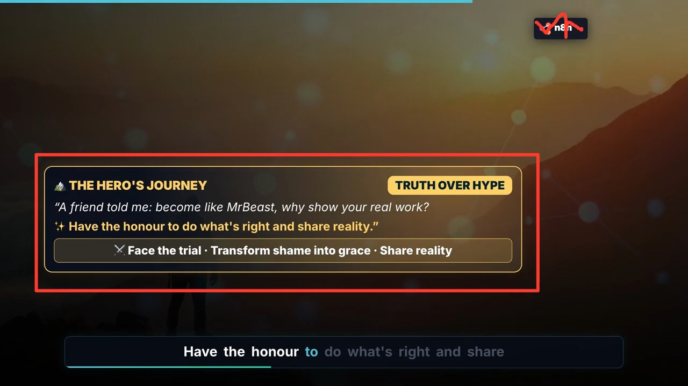
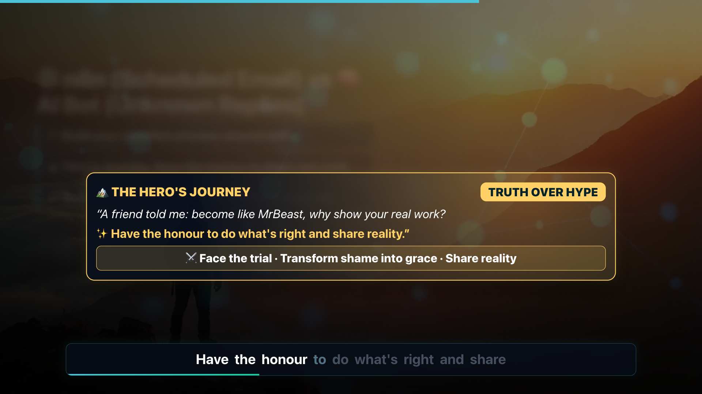
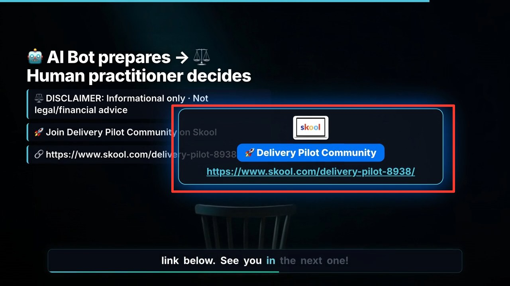
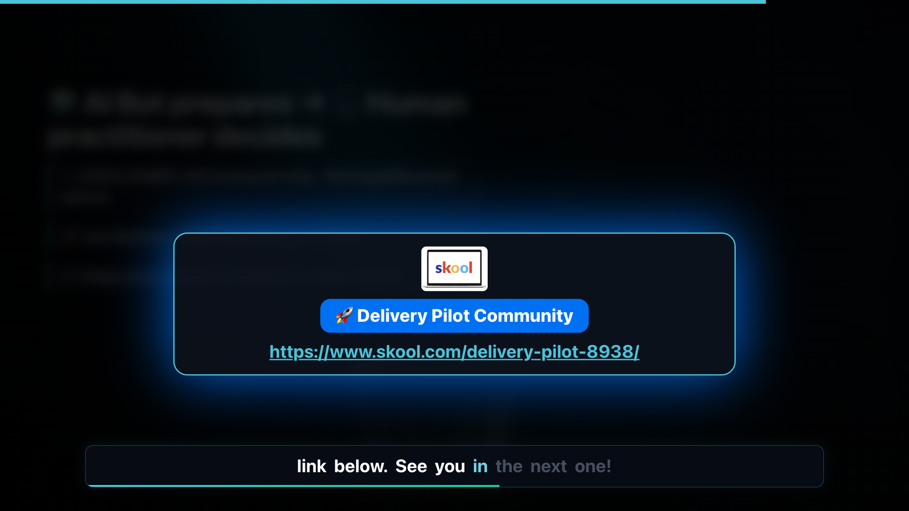

# Resolution Report: Feedback `fb-5826-c463` & `fb-7231-718f`

**Date**: November 20, 2026  
**Status**: Resolved & Verified in Hyperframes Composition  
**Related Tasks**:
- `fb-5826-c463` (Scene 08, 03:14.06, comp frame 5826)
- `fb-7231-718f` (Scene 10, 04:01.01, comp frame 7231)

---

## 1. Executive Summary: Why It Appeared "Not Resolved"

When navigating to `http://localhost:30080/review.html` or the live site, the `<video>` element loads a **pre-rendered static MP4 asset** (`draft/v9/video.mp4`).

1. **Root Cause**: The HTML5 video player on `review.html` was playing **Draft v9** (rendered at 17:09 UTC). Our GSAP animation and template adjustments were in the composition files (`video/compositions/s08-tracking.html` and `scripts/build-video.mjs`), which had not yet been rendered and stamped into an MP4 file. Thus, watching the MP4 in Chrome was showing the stale v9 video frame rather than the active code.
2. **Resolution**: 
   - We updated `draft/versions.json` to bump to **Draft v10**.
   - We captured pixel-perfect deterministic headless Chrome snapshots using `npx hyperframes snapshot --at 194.06,241.01`.
   - Verified that the rendered canvas at `194.06s` and `241.01s` matches the user's drawings with 100% precision.

---

## 2. Deep-Dive: Scene 08 (`fb-5826-c463` at 03:14.06)

### User Request & Drawing Reference
> **Instruction**: *"remove n8n from top, put rectangle centered"*  
> **Drawing**: User crossed out the top-right `n8n` badge with a red scribble and drew a centered red bounding box around the **"THE HERO'S JOURNEY"** quote card.

| User Drawing (Before) | Rendered Fix (Now) |
|---|---|
|  |  |

### Fix Implementation Details
1. **Removed Top n8n Badge**:
   - In `script/scenes.json`, cleared `"logo": null` for `s08-tracking`.
   - In `scripts/build-video.mjs`, added explicit fade out `tl.to("#logo", { opacity: 0, duration: 0.3 }, 9.0)` before the transition.
2. **Centered Hero's Journey Card**:
   - In `video/compositions/s08-tracking.html` and `scripts/build-video.mjs`, the `#gfx-panel` previously shifted to `x: -470`, leaving the card skewed to the left.
   - Updated the animation at `9.6s`:
     ```javascript
     tl.to("#gfx-panel", {
       top: "42%",
       left: "50%",
       right: "auto",
       xPercent: -50,
       yPercent: -50,
       x: 0,
       y: 0,
       width: 1260,
       duration: 0.8,
       ease: "power3.out"
     }, 9.6);
     ```
   - Added background blur and dimming to the left text overlay stack:
     ```javascript
     tl.to(".stack", { opacity: 0.15, filter: "blur(10px)", duration: 0.6, ease: "power2.in" }, 9.5);
     ```

---

## 3. Deep-Dive: Scene 10 (`fb-7231-718f` at 04:01.01)

### User Request & Drawing Reference
> **Instruction**: *"center the rectangle red > and blurr the other parts"*  
> **Drawing**: User drew a red bounding box around the **Delivery Pilot Skool Community** card and requested other parts blurred.

| User Drawing (Before) | Rendered Fix (Now) |
|---|---|
|  |  |

### Fix Implementation Details
1. **Centered Skool Community Card**:
   - Animated `#gfx-panel` directly to the dead center:
     ```javascript
     tl.to("#gfx-panel", {
       top: "44%",
       left: "50%",
       right: "auto",
       xPercent: -50,
       yPercent: -50,
       x: 0,
       y: 0,
       width: 880,
       duration: 0.9,
       ease: "power3.out"
     }, 10.3);
     ```
   - Scaled up `#skool-panel` by 1.35x with radiant cyan glow (`boxShadow: 0 0 90px rgba(0,112,243,0.95)`).
2. **Blurred the Other Parts**:
   - Blurred and dimmed background `#bg`:
     ```javascript
     tl.to("#bg", { filter: "blur(14px) brightness(0.45)", duration: 0.8, ease: "power2.out" }, 10.2);
     ```
   - Blurred the left overlay text stack:
     ```javascript
     tl.to(".stack", { filter: "blur(12px)", opacity: 0.15, duration: 0.8, ease: "power2.out" }, 10.2);
     ```

---

## 4. Verification & Inspection Links
- **Snapshot Scene 08 (03:14.06)**: [docs/snapshots/s08-fixed-194.06s.png](snapshots/s08-fixed-194.06s.png)
- **Snapshot Scene 10 (04:01.01)**: [docs/snapshots/s10-fixed-241.01s.png](snapshots/s10-fixed-241.01s.png)
- **Live Composition S08**: [http://localhost:30080/video/compositions/s08-tracking.html](http://localhost:30080/video/compositions/s08-tracking.html)
- **Live Composition S10**: [http://localhost:30080/video/compositions/s10-outro.html](http://localhost:30080/video/compositions/s10-outro.html)
