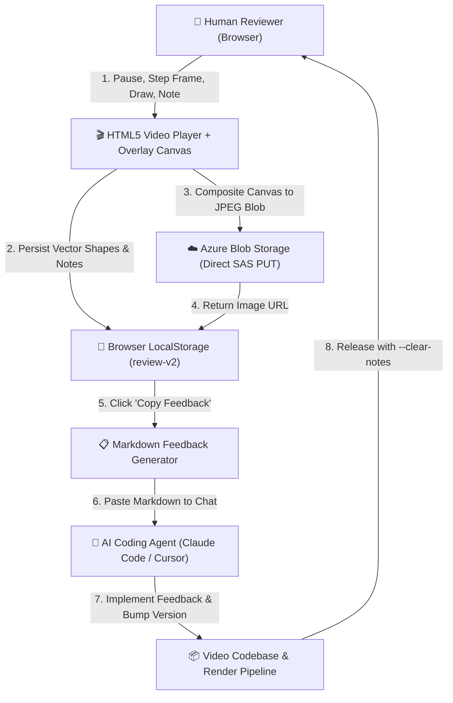

# Video Review & Drawing Annotation Specification

A portable, serverless review framework for video production pipelines (Hyperframes, Remotion, After Effects, or custom web compositions). It enables reviewers to scrub video frame-by-frame, draw visual instructions directly on video frames, automatically upload marked frames to cloud storage (Azure Blob SAS), and export structured Markdown for AI coding agents.

---

## 1. Architecture Overview



### Key Principles
1. **Zero Backend Required**: Runs as a 100% static HTML/JS web page (e.g. hosted on GitHub Pages, Vercel, or S3).
2. **Deterministic Frame Accuracy**: Timecodes are converted to exact video frames based on composition FPS (`Math.round(currentTime * FPS)`).
3. **Normalized Vector Coordinate Space**: Drawing strokes use `[0..1]` normalized coordinates so markings scale responsively across mobile, laptop, and 4K displays.
4. **Zero-Secret Cloud Uploads**: The reviewer supplies an Azure Container SAS URL directly in their browser UI or URL hash (`#sas=...`). Secrets are never committed to git.
5. **Lossless Communication Loop**: Outputs grouped Markdown with exact timestamps, frame indices, scene names, and clickable Azure frame URLs for the AI coding agent.

---

## 2. Review Data Schema

Each feedback annotation is stored in browser `localStorage` as a serialized JSON object:

```typescript
interface ReviewMarker {
  cid: string;             // Unique identifier (e.g. 'a1b2c3d4')
  ts: number;              // Creation timestamp (epoch ms)
  state: "backlog" | "in-progress" | "done";
  kind: "marker" | "text"; // Video frame marker vs copy/post feedback
  t: number;               // Exact timecode in seconds (e.g. 17.21)
  frame: number;           // Absolute frame index (e.g. 516 at 30 fps)
  scene: string;           // Target scene ID (e.g. 's02-intro')
  note: string;            // Reviewer instructions
  shapes: Shape[];         // Vector annotations on the frame
  imgUrl?: string;         // Direct Azure Blob Storage image URL
}

interface Shape {
  k: "pen" | "arrow" | "rect" | "circle" | "text";
  c: string;               // Stroke color (e.g. '#ff3b30')
  w: number;               // Line width in px
  p: [number, number][];   // Normalized [x, y] coordinates (0.0 to 1.0)
  t?: string;              // Text payload if k === 'text'
}
```

---

## 3. Drawing Engine & Canvas Synchronization

The review interface overlays an HTML5 `<canvas>` directly over the native `<video>` element within an absolute-positioned container:

```html
<div class="stage">
  <video id="v" controls playsinline poster="poster.jpg"></video>
  <canvas id="cv"></canvas>
</div>
```

### Responsive Video Box Calculation
Videos often letterbox inside their containers. The canvas matches `devicePixelRatio` and bounds drawing strictly to the rendered video rectangle:

```javascript
function videoBox(canvasWidth, canvasHeight) {
  const vw = video.videoWidth || 16;
  const vh = video.videoHeight || 9;
  const scale = Math.min(canvasWidth / vw, canvasHeight / vh);
  return {
    x: (canvasWidth - vw * scale) / 2,
    y: (canvasHeight - vh * scale) / 2,
    w: vw * scale,
    h: vh * scale
  };
}
```

### Pointer Event Mapping
Pointer coordinates are mapped to normalized `[0..1]` fractions:

```javascript
function mapPointer(event, canvas, box) {
  const rect = canvas.getBoundingClientRect();
  return [
    Math.min(1, Math.max(0, (event.clientX - rect.left - box.x) / box.w)),
    Math.min(1, Math.max(0, (event.clientY - rect.top - box.y) / box.h))
  ];
}
```

---

## 4. Azure Blob Direct Upload (No Server Proxy)

When a reviewer marks a frame, the client composites the video frame and vector overlay into an offscreen canvas and uploads it directly to Azure Blob Storage using a container-scoped Shared Access Signature (SAS).

### Upload Flow
```javascript
async function captureFrameBlob(marker) {
  video.pause();
  const originalTime = video.currentTime;
  await seekTo(marker.t);

  const canvas = document.createElement("canvas");
  canvas.width = video.videoWidth || 1280;
  canvas.height = video.videoHeight || 720;
  const ctx = canvas.getContext("2d");

  // 1. Draw video frame
  ctx.drawImage(video, 0, 0, canvas.width, canvas.height);
  // 2. Draw vector overlays
  paintShapes(ctx, marker.shapes, { x: 0, y: 0, w: canvas.width, h: canvas.height });

  await seekTo(originalTime);
  return new Promise((resolve) => canvas.toBlob(resolve, "image/jpeg", 0.88));
}

async function uploadToAzure(marker, sasUrl) {
  const blob = await captureFrameBlob(marker);
  const u = new URL(sasUrl);
  const filename = `review-${formatTimecode(marker.t)}-${marker.cid}.jpg`;
  
  // Destination: https://<account>.blob.core.windows.net/<container>/<folder>/<filename>?<sasToken>
  const putUrl = `${u.origin}${u.pathname.replace(/\/$/, "")}/hyperframes/${filename}${u.search}`;

  const res = await fetch(putUrl, {
    method: "PUT",
    headers: {
      "x-ms-blob-type": "BlockBlob",
      "Content-Type": "image/jpeg"
    },
    body: blob
  });

  if (res.ok) {
    // Store URL for Markdown export
    marker.imgUrl = `${u.origin}${u.pathname.replace(/\/$/, "")}/hyperframes/${filename}${u.search}`;
    persist();
  }
}
```

---

## 5. Markdown Feedback Export Format

Clicking **"📋 Copy feedback for Claude"** generates a standardized Markdown block:

```markdown
Review feedback on "UK Director Liquidation (draft v7)" (page v1.16.0, site v1.16.0)
https://rifaterdemsahin.github.io/hyperframes/review.html

## Scene 02 · Part 1 of 3: AI and real-world red tape (00:14 to 00:37)
- 00:17.21 (frame 516) [drawing: 2 pen] [image: https://animationasistant.blob.core.windows.net/live-overlay-feedback/hyperframes/review-00-17-21-a1b2c3.jpg?...]: remove internal video metadata tags

## Scene 08 · How I keep track of it (02:56 to 03:20)
- 03:06.25 (frame 5587) [drawing: 1 arrow, 1 pen] [image: https://animationasistant.blob.core.windows.net/live-overlay-feedback/hyperframes/review-03-06-25-b4c5d6.jpg?...]: transition to hero journey background on this voiceover cue
```

### Why Agents Love This Format
1. **Zero Ambiguity**: The agent knows the exact frame and scene.
2. **Visual Verification**: The agent can inspect the drawing image via curl or image viewer.
3. **Task Tracking**: Items can be ticked off in order of timecode.

---

## 6. Feedback Implementation & Auto-Clearing Loop

To prevent duplicate work across releases, implemented feedback is automatically cleared from the reviewer's browser without deleting newly added notes:

1. **Agent Implementation**: The coding agent implements the requested changes.
2. **Version Bump with Clear Flag**:
   ```bash
   node scripts/version.mjs bump minor "Implemented review feedback" review.html --clear-notes=review.html
   ```
3. **Stamping `clearedAt`**:
   `version.mjs` stamps `window.SITE_INFO.clearedAt = "2026-11-20T12:00:00Z"` into `nav.js`.
4. **Browser Retention Logic**:
   On the next page load, `review.html` filters out notes created before `clearedAt`:
   ```javascript
   const cleared = (window.SITE_INFO && window.SITE_INFO.clearedAt) || "";
   if (cleared) {
     items = items.filter((i) => !(i.ts && new Date(i.ts).toISOString() < cleared));
     localStorage.setItem(KEY, JSON.stringify(items));
   }
   ```
   *Any notes added after `clearedAt` remain intact.*

---

## 7. Quick Recipe to Replicate in a New Project

1. **Copy the Review Generator**: Copy `scripts/build-review-page.mjs` into your new repo.
2. **Point to Video Assets**: In your project spec, define your scenes and output MP4 path (`draft/video.mp4`).
3. **Configure Azure Container SAS**:
   - Create a private Azure Blob Container (e.g. `video-reviews`).
   - Generate a container SAS token with `racwdl` permissions (Read, Add, Create, Write, Delete, List).
   - In the review page UI, paste the SAS URL or bookmark with `#sas=<url_encoded_sas>`.
4. **Add Version Clearing**: Use `version.mjs` to bump versions and stamp `clearedAt`.
