# Keynote text audit: v10

Generated by `node scripts/audit-keynote.mjs --label=v10 --mp4=draft/v10/video.mp4`. Each scene's timeline was stepped every 0.25 s in headless Chrome at 1920x1080 and every visible text block measured.

**163 moments with text, 163 flagged as TOO MUCH TEXT.** 

Rules: more than 6 words · more than 2 lines · any list · more than one text element (tiny labels excepted) · font under 96 px · text over 20% of the frame.

Every 2 s of the MP4: [contact sheet](v10/contact-sheet-every-2s.jpg)

| Timestamp | Clip id | Words | Rule broken | Screenshot |
|---|---|---|---|---|
| 00:00.50 (s01-hook +0.50s) | `#head`, `#c0` | 12: "🏁 The end of the company / My company is coming to an end," | 12 words, 2 text elements, font 38px | 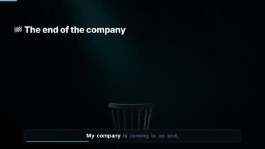 |
| 00:02.50 (s01-hook +2.50s) | `#head`, `#c1` | 10: "🏁 The end of the company / and I'm closing it properly." | 10 words, 2 text elements, font 38px | 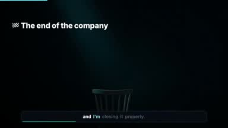 |
| 00:04.00 (s01-hook +4.00s) | `#head` | 5: "🏁 The end of the company" | font 64px | 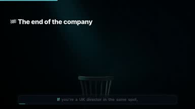 |
| 00:04.25 (s01-hook +4.25s) | `#head`, `#c2` | 14: "🏁 The end of the company / If you're a UK director in the same spot," | 14 words, 2 text elements, font 38px | 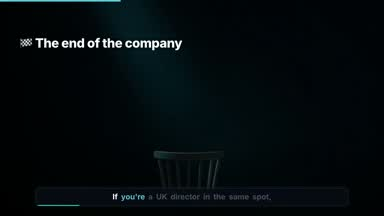 |
| 00:04.50 (s01-hook +4.50s) | `#head`, `#l0`, `#c2` | 19: "🏁 The end of the company / ✅ Closing it properly with dignity / If you're a UK director in the same spot," | 19 words, 3 lines, 3 text elements, font 34px | 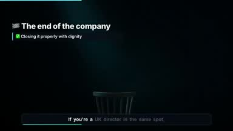 |
| 00:06.25 (s01-hook +6.25s) | `#head`, `#l0`, `#core-badge`, `#core-panel div.core-headline`, `#core-panel div.core-sub`, `#c2` | 42: "🏁 The end of the company / ✅ Closing it properly with dignity / CORE STRATEGY / In the Age of AI / AI is the director's core operational ba" | 42 words, 8 lines, 5 text elements, font 28px | 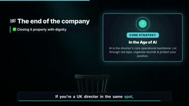 |
| 00:07.00 (s01-hook +7.00s) | `#head`, `#l0`, `#core-badge`, `#core-panel div.core-headline`, `#core-panel div.core-sub`, `#c3` | 42: "🏁 The end of the company / ✅ Closing it properly with dignity / CORE STRATEGY / In the Age of AI / AI is the director's core operational ba" | 42 words, 8 lines, 5 text elements, font 28px | 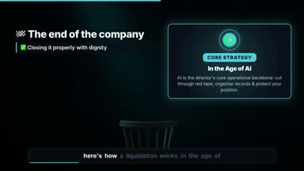 |
| 00:07.75 (s01-hook +7.75s) | `#head`, `#l0`, `#l1`, `#core-badge`, `#core-panel div.core-headline`, `#core-panel div.core-sub`, `#c3` | 51: "🏁 The end of the company / ✅ Closing it properly with dignity / ⚡ The Core Strategy: Liquidating in the Age of AI 🤖 / CORE STRATEGY / In t" | 51 words, 9 lines, 6 text elements, font 28px | 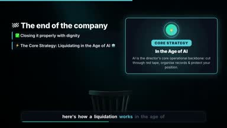 |
| 00:09.75 (s01-hook +9.75s) | `#head`, `#l0`, `#l1`, `#core-badge`, `#core-panel div.core-headline`, `#core-panel div.core-sub`, `#c4` | 50: "🏁 The end of the company / ✅ Closing it properly with dignity / ⚡ The Core Strategy: Liquidating in the Age of AI 🤖 / CORE STRATEGY / In t" | 50 words, 9 lines, 6 text elements, font 28px | 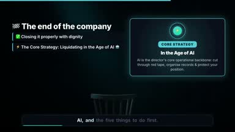 |
| 00:12.25 (s01-hook +12.25s) | `#head`, `#l0`, `#l1`, `#core-badge`, `#core-panel div.core-headline`, `#core-panel div.core-sub` | 42: "🏁 The end of the company / ✅ Closing it properly with dignity / ⚡ The Core Strategy: Liquidating in the Age of AI 🤖 / CORE STRATEGY / In t" | 42 words, 8 lines, 5 text elements, font 28px | 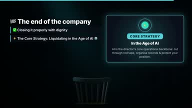 |
| 00:14.50 (s02-intro +0.50s) | `#head`, `#c0` | 15: "💼 Part 1 of 3 · UK IT Contractor / I'm Rifat, an IT contractor based in Cambridge." | 15 words, list, 2 text elements, font 38px |  |
| 00:17.25 (s02-intro +3.25s) | `#head`, `#c1` | 8: "💼 Part 1 of 3 · UK IT Contractor / The" | 8 words, list, font 38px |  |
| 00:17.50 (s02-intro +3.50s) | `#head`, `#c1` | 14: "💼 Part 1 of 3 · UK IT Contractor / The tax rules in the UK changed," | 14 words, list, 2 text elements, font 38px |  |
| 00:20.00 (s02-intro +6.00s) | `#head`, `#l0`, `#c2` | 24: "💼 Part 1 of 3 · UK IT Contractor / 🏛️ UK tax rules changed: involuntary push inside IR35 / creating an involuntary push from outside to in" | 24 words, 3 lines, list, 3 text elements, font 34px |  |
| 00:23.25 (s02-intro +9.25s) | `#head`, `#l0`, `#c3` | 22: "💼 Part 1 of 3 · UK IT Contractor / 🏛️ UK tax rules changed: involuntary push inside IR35 / roles as the market took a downturn." | 22 words, 3 lines, list, 3 text elements, font 34px |  |
| 00:24.25 (s02-intro +10.25s) | `#head`, `#l0`, `#l1`, `#c3` | 26: "💼 Part 1 of 3 · UK IT Contractor / 🏛️ UK tax rules changed: involuntary push inside IR35 / 📉 Market downturn & contracting shift / roles " | 26 words, 4 lines, list, 4 text elements, font 34px |  |
| 00:25.75 (s02-intro +11.75s) | `#head`, `#l0`, `#l1` | 19: "💼 Part 1 of 3 · UK IT Contractor / 🏛️ UK tax rules changed: involuntary push inside IR35 / 📉 Market downturn & contracting shift" | 19 words, 3 lines, list, 3 text elements, font 34px |  |
| 00:26.00 (s02-intro +12.00s) | `#head`, `#l0`, `#l1`, `#c4` | 25: "💼 Part 1 of 3 · UK IT Contractor / 🏛️ UK tax rules changed: involuntary push inside IR35 / 📉 Market downturn & contracting shift / Doing " | 25 words, 4 lines, list, 4 text elements, font 34px |  |
| 00:28.00 (s02-intro +14.00s) | `#head`, `#l0`, `#l1` | 19: "💼 Part 1 of 3 · UK IT Contractor / 🏛️ UK tax rules changed: involuntary push inside IR35 / 📉 Market downturn & contracting shift" | 19 words, 3 lines, list, 3 text elements, font 34px |  |
| 00:28.25 (s02-intro +14.25s) | `#head`, `#l0`, `#l1`, `#l2`, `#c5` | 34: "💼 Part 1 of 3 · UK IT Contractor / 🏛️ UK tax rules changed: involuntary push inside IR35 / 📉 Market downturn & contracting shift / 🤖 Nav" | 34 words, 5 lines, list, 5 text elements, font 34px | 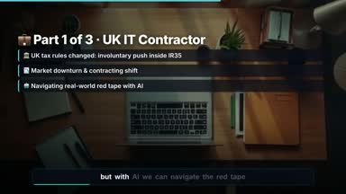 |
| 00:31.50 (s02-intro +17.50s) | `#head`, `#l0`, `#l1`, `#l2`, `#c6` | 35: "💼 Part 1 of 3 · UK IT Contractor / 🏛️ UK tax rules changed: involuntary push inside IR35 / 📉 Market downturn & contracting shift / 🤖 Nav" | 35 words, 5 lines, list, 5 text elements, font 34px |  |
| 00:35.25 (s02-intro +21.25s) | `#head`, `#l0`, `#l1`, `#l2` | 25: "💼 Part 1 of 3 · UK IT Contractor / 🏛️ UK tax rules changed: involuntary push inside IR35 / 📉 Market downturn & contracting shift / 🤖 Nav" | 25 words, 4 lines, list, 4 text elements, font 34px |  |
| 00:37.50 (s03-goal +0.50s) | `#head`, `#c0` | 16: "📜 Industrial & Information revolutions brought massive red tape / Here's the goal. The industrial and the information revolutions" | 16 words, 4 lines, 2 text elements, font 38px | 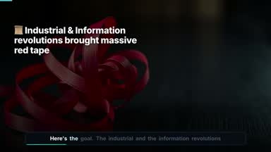 |
| 00:38.25 (s03-goal +1.25s) | `#head`, `#gfx-panel div`, `#gfx-panel span`, `#gfx-panel span`, `#gfx-panel div`, `#gfx-panel span`, `#gfx-panel span`, `#gfx-panel span`, `#gfx-panel span`, `#gfx-panel span`, `#gfx-panel span`, `#c0` | 50: "📜 Industrial & Information revolutions brought massive red tape / 🏛️ Legal Separation Rule / Company Debt / Stays With the Company / Three" | 50 words, 14 lines, list, 11 text elements, font 28px | 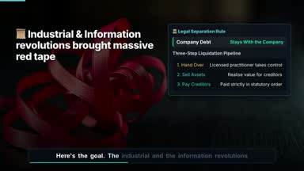 |
| 00:41.00 (s03-goal +4.00s) | `#head`, `#gfx-panel div`, `#gfx-panel span`, `#gfx-panel span`, `#gfx-panel div`, `#gfx-panel span`, `#gfx-panel span`, `#gfx-panel span`, `#gfx-panel span`, `#gfx-panel span`, `#gfx-panel span`, `#c1` | 46: "📜 Industrial & Information revolutions brought massive red tape / 🏛️ Legal Separation Rule / Company Debt / Stays With the Company / Three" | 46 words, 14 lines, list, 11 text elements, font 28px | 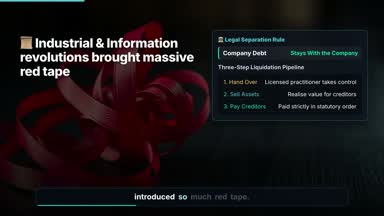 |
| 00:42.25 (s03-goal +5.25s) | `#head`, `#l0`, `#gfx-panel div`, `#gfx-panel span`, `#gfx-panel span`, `#gfx-panel div`, `#gfx-panel span`, `#gfx-panel span`, `#gfx-panel span`, `#gfx-panel span`, `#gfx-panel span`, `#gfx-panel span`, `#c1` | 51: "📜 Industrial & Information revolutions brought massive red tape / ⚖️ Company debt stays the company's / 🏛️ Legal Separation Rule / Company" | 51 words, 15 lines, list, 12 text elements, font 28px | 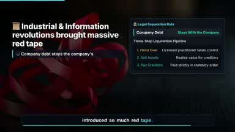 |
| 00:42.75 (s03-goal +5.75s) | `#head`, `#l0`, `#gfx-panel div`, `#gfx-panel span`, `#gfx-panel span`, `#gfx-panel div`, `#gfx-panel span`, `#gfx-panel span`, `#gfx-panel span`, `#gfx-panel span`, `#gfx-panel span`, `#gfx-panel span` | 46: "📜 Industrial & Information revolutions brought massive red tape / ⚖️ Company debt stays the company's / 🏛️ Legal Separation Rule / Company" | 46 words, 14 lines, list, 11 text elements, font 28px | 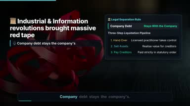 |
| 00:43.00 (s03-goal +6.00s) | `#head`, `#l0`, `#gfx-panel div`, `#gfx-panel span`, `#gfx-panel span`, `#gfx-panel div`, `#gfx-panel span`, `#gfx-panel span`, `#gfx-panel span`, `#gfx-panel span`, `#gfx-panel span`, `#gfx-panel span`, `#c2` | 51: "📜 Industrial & Information revolutions brought massive red tape / ⚖️ Company debt stays the company's / 🏛️ Legal Separation Rule / Company" | 51 words, 15 lines, list, 12 text elements, font 28px | 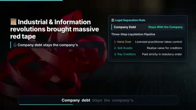 |
| 00:44.75 (s03-goal +7.75s) | `#head`, `#l0`, `#gfx-panel div`, `#gfx-panel span`, `#gfx-panel span`, `#gfx-panel div`, `#gfx-panel span`, `#gfx-panel span`, `#gfx-panel span`, `#gfx-panel span`, `#gfx-panel span`, `#gfx-panel span`, `#c3` | 54: "📜 Industrial & Information revolutions brought massive red tape / ⚖️ Company debt stays the company's / 🏛️ Legal Separation Rule / Company" | 54 words, 15 lines, list, 12 text elements, font 28px | 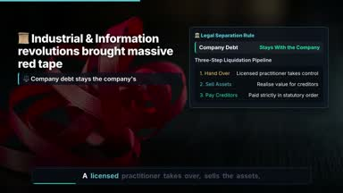 |
| 00:45.75 (s03-goal +8.75s) | `#head`, `#l0`, `#l1`, `#gfx-panel div`, `#gfx-panel span`, `#gfx-panel span`, `#gfx-panel div`, `#gfx-panel span`, `#gfx-panel span`, `#gfx-panel span`, `#gfx-panel span`, `#gfx-panel span`, `#gfx-panel span`, `#c3` | 65: "📜 Industrial & Information revolutions brought massive red tape / ⚖️ Company debt stays the company's / 1️⃣ Hand over → 2️⃣ Sell assets → 3" | 65 words, 16 lines, list, 13 text elements, font 28px | 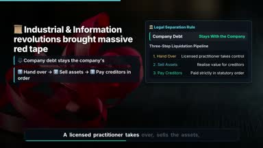 |
| 00:48.00 (s03-goal +11.00s) | `#head`, `#l0`, `#l1`, `#gfx-panel div`, `#gfx-panel span`, `#gfx-panel span`, `#gfx-panel div`, `#gfx-panel span`, `#gfx-panel span`, `#gfx-panel span`, `#gfx-panel span`, `#gfx-panel span`, `#gfx-panel span`, `#c4` | 62: "📜 Industrial & Information revolutions brought massive red tape / ⚖️ Company debt stays the company's / 1️⃣ Hand over → 2️⃣ Sell assets → 3" | 62 words, 16 lines, list, 13 text elements, font 28px | 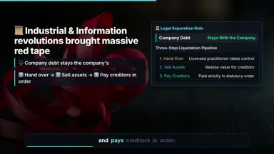 |
| 00:49.00 (s03-goal +12.00s) | `#head`, `#l0`, `#l1`, `#l2`, `#gfx-panel div`, `#gfx-panel span`, `#gfx-panel span`, `#gfx-panel div`, `#gfx-panel span`, `#gfx-panel span`, `#gfx-panel span`, `#gfx-panel span`, `#gfx-panel span`, `#gfx-panel span`, `#c4` | 67: "📜 Industrial & Information revolutions brought massive red tape / ⚖️ Company debt stays the company's / 1️⃣ Hand over → 2️⃣ Sell assets → 3" | 67 words, 17 lines, list, 14 text elements, font 28px | 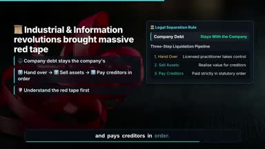 |
| 00:50.00 (s03-goal +13.00s) | `#head`, `#l0`, `#l1`, `#l2`, `#gfx-panel div`, `#gfx-panel span`, `#gfx-panel span`, `#gfx-panel div`, `#gfx-panel span`, `#gfx-panel span`, `#gfx-panel span`, `#gfx-panel span`, `#gfx-panel span`, `#gfx-panel span`, `#c5` | 71: "📜 Industrial & Information revolutions brought massive red tape / ⚖️ Company debt stays the company's / 1️⃣ Hand over → 2️⃣ Sell assets → 3" | 71 words, 17 lines, list, 14 text elements, font 28px | 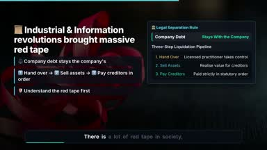 |
| 00:53.50 (s03-goal +16.50s) | `#head`, `#l0`, `#l1`, `#l2`, `#gfx-panel div`, `#gfx-panel span`, `#gfx-panel span`, `#gfx-panel div`, `#gfx-panel span`, `#gfx-panel span`, `#gfx-panel span`, `#gfx-panel span`, `#gfx-panel span`, `#gfx-panel span`, `#c6` | 66: "📜 Industrial & Information revolutions brought massive red tape / ⚖️ Company debt stays the company's / 1️⃣ Hand over → 2️⃣ Sell assets → 3" | 66 words, 17 lines, list, 14 text elements, font 28px | 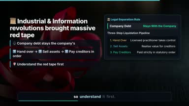 |
| 00:55.00 (s03-goal +18.00s) | `#head`, `#l0`, `#l1`, `#l2`, `#gfx-panel div`, `#gfx-panel span`, `#gfx-panel span`, `#gfx-panel div`, `#gfx-panel span`, `#gfx-panel span`, `#gfx-panel span`, `#gfx-panel span`, `#gfx-panel span`, `#gfx-panel span` | 62: "📜 Industrial & Information revolutions brought massive red tape / ⚖️ Company debt stays the company's / 1️⃣ Hand over → 2️⃣ Sell assets → 3" | 62 words, 16 lines, list, 13 text elements, font 28px | 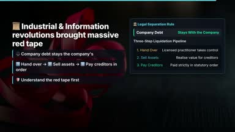 |
| 00:57.50 (s04-five-things +0.50s) | `#head`, `#c0` | 16: "⚡ Five things to do first (with AI 🤖) / Five things to do first, with AI as your" | 16 words, 3 lines, 2 text elements, font 38px |  |
| 01:00.50 (s04-five-things +3.50s) | `#head`, `#c1` | 16: "⚡ Five things to do first (with AI 🤖) / support. Remember, this is what I learned from AI," | 16 words, 3 lines, 2 text elements, font 38px |  |
| 01:03.50 (s04-five-things +6.50s) | `#head`, `#c2` | 16: "⚡ Five things to do first (with AI 🤖) / not financial advice. Your job is to learn with" | 16 words, 3 lines, 2 text elements, font 38px |  |
| 01:04.25 (s04-five-things +7.25s) | `#head`, `#l0`, `#c2` | 24: "⚡ Five things to do first (with AI 🤖) / ⚠️ What I learned from AI · Not financial advice / not financial advice. Your job is to learn with" | 24 words, 4 lines, list, 3 text elements, font 34px |  |
| 01:06.50 (s04-five-things +9.50s) | `#head`, `#l0`, `#c3` | 21: "⚡ Five things to do first (with AI 🤖) / ⚠️ What I learned from AI · Not financial advice / AI. One: check your HMRC balance." | 21 words, 4 lines, list, 3 text elements, font 34px |  |
| 01:08.25 (s04-five-things +11.25s) | `#head`, `#l0`, `#l1`, `#chatgpt-card span`, `#chatgpt-card div.chatgpt-pill`, `#c3` | 31: "⚡ Five things to do first (with AI 🤖) / ⚠️ What I learned from AI · Not financial advice / 🎯 Your job is to learn with AI / ChatGPT Co-Pil" | 31 words, 7 lines, list, 4 text elements, font 28px |  |
| 01:08.50 (s04-five-things +11.50s) | `#head`, `#l0`, `#l1`, `#chatgpt-card span`, `#chatgpt-card div.chatgpt-pill`, `#c4` | 32: "⚡ Five things to do first (with AI 🤖) / ⚠️ What I learned from AI · Not financial advice / 🎯 Your job is to learn with AI / ChatGPT Co-Pil" | 32 words, 7 lines, list, 4 text elements, font 28px |  |
| 01:09.00 (s04-five-things +12.00s) | `#head`, `#l0`, `#l1`, `#chatgpt-card span`, `#chatgpt-card div.chatgpt-pill`, `#chat-user`, `#c4` | 42: "⚡ Five things to do first (with AI 🤖) / ⚠️ What I learned from AI · Not financial advice / 🎯 Your job is to learn with AI / ChatGPT Co-Pil" | 42 words, 9 lines, list, 5 text elements, font 28px |  |
| 01:09.75 (s04-five-things +12.75s) | `#head`, `#l0`, `#l1`, `#chatgpt-card span`, `#chatgpt-card div.chatgpt-pill`, `#chat-user`, `#chat-ai`, `#c4` | 58: "⚡ Five things to do first (with AI 🤖) / ⚠️ What I learned from AI · Not financial advice / 🎯 Your job is to learn with AI / ChatGPT Co-Pil" | 58 words, 11 lines, list, 6 text elements, font 28px |  |
| 01:10.75 (s04-five-things +13.75s) | `#head`, `#l0`, `#l1`, `#chatgpt-card span`, `#chatgpt-card div.chatgpt-pill`, `#chat-user`, `#chat-ai`, `#chat-learn`, `#c4` | 67: "⚡ Five things to do first (with AI 🤖) / ⚠️ What I learned from AI · Not financial advice / 🎯 Your job is to learn with AI / ChatGPT Co-Pil" | 67 words, 13 lines, list, 7 text elements, font 28px |  |
| 01:11.00 (s04-five-things +14.00s) | `#head`, `#l0`, `#l1`, `#chatgpt-card span`, `#chatgpt-card div.chatgpt-pill`, `#chat-user`, `#chat-ai`, `#chat-learn`, `#c5` | 66: "⚡ Five things to do first (with AI 🤖) / ⚠️ What I learned from AI · Not financial advice / 🎯 Your job is to learn with AI / ChatGPT Co-Pil" | 66 words, 13 lines, list, 7 text elements, font 28px |  |
| 01:12.25 (s04-five-things +15.25s) | `#head`, `#l0`, `#l1`, `#l2`, `#chatgpt-card span`, `#chatgpt-card div.chatgpt-pill`, `#chat-user`, `#chat-ai`, `#chat-learn`, `#c5` | 74: "⚡ Five things to do first (with AI 🤖) / ⚠️ What I learned from AI · Not financial advice / 🎯 Your job is to learn with AI / 1️⃣ Check HMRC" | 74 words, 14 lines, list, 8 text elements, font 28px |  |
| 01:12.75 (s04-five-things +15.75s) | `#head`, `#l0`, `#l1`, `#l2`, `#chatgpt-card span`, `#chatgpt-card div.chatgpt-pill`, `#chat-user`, `#chat-ai`, `#chat-learn`, `#trustpilot-card span.tp-score`, `#trustpilot-card div.tp-sub`, `#c5` | 80: "⚡ Five things to do first (with AI 🤖) / ⚠️ What I learned from AI · Not financial advice / 🎯 Your job is to learn with AI / 1️⃣ Check HMRC" | 80 words, 17 lines, list, 9 text elements, font 28px |  |
| 01:13.00 (s04-five-things +16.00s) | `#head`, `#l0`, `#l1`, `#l2`, `#chatgpt-card span`, `#chatgpt-card div.chatgpt-pill`, `#chat-user`, `#chat-ai`, `#chat-learn`, `#trustpilot-card span.tp-score`, `#trustpilot-card div.tp-sub`, `#c6` | 82: "⚡ Five things to do first (with AI 🤖) / ⚠️ What I learned from AI · Not financial advice / 🎯 Your job is to learn with AI / 1️⃣ Check HMRC" | 82 words, 17 lines, list, 9 text elements, font 28px |  |
| 01:15.75 (s04-five-things +18.75s) | `#head`, `#l0`, `#l1`, `#l2`, `#chatgpt-card span`, `#chatgpt-card div.chatgpt-pill`, `#chat-user`, `#chat-ai`, `#chat-learn`, `#trustpilot-card span.tp-score`, `#trustpilot-card div.tp-sub`, `#c7` | 83: "⚡ Five things to do first (with AI 🤖) / ⚠️ What I learned from AI · Not financial advice / 🎯 Your job is to learn with AI / 1️⃣ Check HMRC" | 83 words, 17 lines, list, 9 text elements, font 28px |  |
| 01:16.25 (s04-five-things +19.25s) | `#head`, `#l0`, `#l1`, `#l2`, `#l3`, `#chatgpt-card span`, `#chatgpt-card div.chatgpt-pill`, `#chat-user`, `#chat-ai`, `#chat-learn`, `#trustpilot-card span.tp-score`, `#trustpilot-card div.tp-sub`, `#c7` | 89: "⚡ Five things to do first (with AI 🤖) / ⚠️ What I learned from AI · Not financial advice / 🎯 Your job is to learn with AI / 1️⃣ Check HMRC" | 89 words, 18 lines, list, 10 text elements, font 28px |  |
| 01:17.00 (s04-five-things +20.00s) | `#head`, `#l0`, `#l1`, `#l2`, `#l3`, `#chatgpt-card span`, `#chatgpt-card div.chatgpt-pill`, `#chat-user`, `#chat-ai`, `#chat-learn`, `#c7` | 83: "⚡ Five things to do first (with AI 🤖) / ⚠️ What I learned from AI · Not financial advice / 🎯 Your job is to learn with AI / 1️⃣ Check HMRC" | 83 words, 15 lines, list, 9 text elements, font 28px |  |
| 01:18.75 (s04-five-things +21.75s) | `#head`, `#l0`, `#l1`, `#l2`, `#l3`, `#chatgpt-card span`, `#chatgpt-card div.chatgpt-pill`, `#chat-user`, `#chat-ai`, `#chat-learn`, `#c8` | 82: "⚡ Five things to do first (with AI 🤖) / ⚠️ What I learned from AI · Not financial advice / 🎯 Your job is to learn with AI / 1️⃣ Check HMRC" | 82 words, 15 lines, list, 9 text elements, font 28px |  |
| 01:20.00 (s04-five-things +23.00s) | `#head`, `#l0`, `#l1`, `#l2`, `#l3`, `#l4`, `#chatgpt-card span`, `#chatgpt-card div.chatgpt-pill`, `#chat-user`, `#chat-ai`, `#chat-learn`, `#c8` | 89: "⚡ Five things to do first (with AI 🤖) / ⚠️ What I learned from AI · Not financial advice / 🎯 Your job is to learn with AI / 1️⃣ Check HMRC" | 89 words, 16 lines, list, 10 text elements, font 28px |  |
| 01:21.50 (s04-five-things +24.50s) | `#head`, `#l0`, `#l1`, `#l2`, `#l3`, `#l4`, `#chatgpt-card span`, `#chatgpt-card div.chatgpt-pill`, `#chat-user`, `#chat-ai`, `#chat-learn`, `#c9` | 90: "⚡ Five things to do first (with AI 🤖) / ⚠️ What I learned from AI · Not financial advice / 🎯 Your job is to learn with AI / 1️⃣ Check HMRC" | 90 words, 16 lines, list, 10 text elements, font 28px |  |
| 01:24.00 (s04-five-things +27.00s) | `#head`, `#l0`, `#l1`, `#l2`, `#l3`, `#l4`, `#l5`, `#chatgpt-card span`, `#chatgpt-card div.chatgpt-pill`, `#chat-user`, `#chat-ai`, `#chat-learn`, `#c9` | 97: "⚡ Five things to do first (with AI 🤖) / ⚠️ What I learned from AI · Not financial advice / 🎯 Your job is to learn with AI / 1️⃣ Check HMRC" | 97 words, 17 lines, list, 11 text elements, font 28px |  |
| 01:24.50 (s04-five-things +27.50s) | `#head`, `#l0`, `#l1`, `#l2`, `#l3`, `#l4`, `#l5`, `#chatgpt-card span`, `#chatgpt-card div.chatgpt-pill`, `#chat-user`, `#chat-ai`, `#chat-learn`, `#c10` | 97: "⚡ Five things to do first (with AI 🤖) / ⚠️ What I learned from AI · Not financial advice / 🎯 Your job is to learn with AI / 1️⃣ Check HMRC" | 97 words, 17 lines, list, 11 text elements, font 28px |  |
| 01:27.50 (s04-five-things +30.50s) | `#head`, `#l0`, `#l1`, `#l2`, `#l3`, `#l4`, `#l5`, `#chatgpt-card span`, `#chatgpt-card div.chatgpt-pill`, `#chat-user`, `#chat-ai`, `#chat-learn`, `#c11` | 97: "⚡ Five things to do first (with AI 🤖) / ⚠️ What I learned from AI · Not financial advice / 🎯 Your job is to learn with AI / 1️⃣ Check HMRC" | 97 words, 17 lines, list, 11 text elements, font 28px |  |
| 01:30.50 (s04-five-things +33.50s) | `#head`, `#l0`, `#l1`, `#l2`, `#l3`, `#l4`, `#l5`, `#chatgpt-card span`, `#chatgpt-card div.chatgpt-pill`, `#chat-user`, `#chat-ai`, `#chat-learn`, `#c12` | 97: "⚡ Five things to do first (with AI 🤖) / ⚠️ What I learned from AI · Not financial advice / 🎯 Your job is to learn with AI / 1️⃣ Check HMRC" | 97 words, 17 lines, list, 11 text elements, font 28px |  |
| 01:33.50 (s04-five-things +36.50s) | `#head`, `#l0`, `#l1`, `#l2`, `#l3`, `#l4`, `#l5`, `#chatgpt-card span`, `#chatgpt-card div.chatgpt-pill`, `#chat-user`, `#chat-ai`, `#chat-learn` | 88: "⚡ Five things to do first (with AI 🤖) / ⚠️ What I learned from AI · Not financial advice / 🎯 Your job is to learn with AI / 1️⃣ Check HMRC" | 88 words, 16 lines, list, 10 text elements, font 28px |  |
| 01:33.75 (s04-five-things +36.75s) | `#head`, `#l0`, `#l1`, `#l2`, `#l3`, `#l4`, `#l5`, `#chatgpt-card span`, `#chatgpt-card div.chatgpt-pill`, `#chat-user`, `#chat-ai`, `#chat-learn`, `#c13` | 92: "⚡ Five things to do first (with AI 🤖) / ⚠️ What I learned from AI · Not financial advice / 🎯 Your job is to learn with AI / 1️⃣ Check HMRC" | 92 words, 17 lines, list, 11 text elements, font 28px |  |
| 01:35.00 (s04-five-things +38.00s) | `#head`, `#l0`, `#l1`, `#l2`, `#l3`, `#l4`, `#l5`, `#chatgpt-card span`, `#chatgpt-card div.chatgpt-pill`, `#chat-user`, `#chat-ai`, `#chat-learn` | 88: "⚡ Five things to do first (with AI 🤖) / ⚠️ What I learned from AI · Not financial advice / 🎯 Your job is to learn with AI / 1️⃣ Check HMRC" | 88 words, 16 lines, list, 10 text elements, font 28px |  |
| 01:37.50 (s05-cost-timeline +0.50s) | `#head`, `#c0` | 10: "⚡ YOU + AI = LEVERAGE 🚀 / Here's what it costs: a £1,500 deposit," | 10 words, 2 text elements, font 38px |  |
| 01:38.25 (s05-cost-timeline +1.25s) | `#head`, `#leverage-pill`, `#gfx-panel div`, `#gfx-panel span`, `#gfx-panel span.fee-highlight`, `#gfx-panel span`, `#gfx-panel span.fee-highlight`, `#gfx-panel span`, `#gfx-panel span`, `#gfx-panel div`, `#gfx-panel div.tl-label`, `#gfx-panel div.tl-label`, `#gfx-panel div.tl-label`, `#c0` | 38: "⚡ YOU + AI = LEVERAGE 🚀 / ⚡ YOU + AI = LEVERAGE / Liquidation Fees (UK Provider) / Deposit to start / £1,500 / Balance to complete / £2,100" | 38 words, 14 lines, 8 text elements, font 28px |  |
| 01:39.50 (s05-cost-timeline +2.50s) | `#head`, `#leverage-pill`, `#gfx-panel div`, `#gfx-panel span`, `#gfx-panel span.fee-highlight`, `#gfx-panel span`, `#gfx-panel span.fee-highlight`, `#gfx-panel span`, `#gfx-panel span`, `#gfx-panel div`, `#gfx-panel div.tl-label`, `#gfx-panel div.tl-label`, `#gfx-panel div.tl-label`, `#c1` | 40: "⚡ YOU + AI = LEVERAGE 🚀 / ⚡ YOU + AI = LEVERAGE / Liquidation Fees (UK Provider) / Deposit to start / £1,500 / Balance to complete / £2,100" | 40 words, 14 lines, 8 text elements, font 28px |  |
| 01:42.25 (s05-cost-timeline +5.25s) | `#head`, `#leverage-pill`, `#gfx-panel div`, `#gfx-panel span`, `#gfx-panel span.fee-highlight`, `#gfx-panel span`, `#gfx-panel span.fee-highlight`, `#gfx-panel span`, `#gfx-panel span`, `#gfx-panel div`, `#gfx-panel div.tl-label`, `#gfx-panel div.tl-label`, `#gfx-panel div.tl-label`, `#c2` | 40: "⚡ YOU + AI = LEVERAGE 🚀 / ⚡ YOU + AI = LEVERAGE / Liquidation Fees (UK Provider) / Deposit to start / £1,500 / Balance to complete / £2,100" | 40 words, 14 lines, 8 text elements, font 28px |  |
| 01:43.00 (s05-cost-timeline +6.00s) | `#head`, `#l0`, `#leverage-pill`, `#gfx-panel div`, `#gfx-panel span`, `#gfx-panel span.fee-highlight`, `#gfx-panel span`, `#gfx-panel span.fee-highlight`, `#gfx-panel span`, `#gfx-panel span`, `#gfx-panel div`, `#gfx-panel div.tl-label`, `#gfx-panel div.tl-label`, `#gfx-panel div.tl-label`, `#c2` | 48: "⚡ YOU + AI = LEVERAGE 🚀 / 💷 Fee to liquidation company: £1,500 deposit + £2,100 balance / ⚡ YOU + AI = LEVERAGE / Liquidation Fees (UK Pro" | 48 words, 16 lines, 9 text elements, font 28px |  |
| 01:44.75 (s05-cost-timeline +7.75s) | `#head`, `#l0`, `#leverage-pill`, `#gfx-panel div`, `#gfx-panel span`, `#gfx-panel span.fee-highlight`, `#gfx-panel span`, `#gfx-panel span.fee-highlight`, `#gfx-panel span`, `#gfx-panel span`, `#gfx-panel div`, `#gfx-panel div.tl-label`, `#gfx-panel div.tl-label`, `#gfx-panel div.tl-label` | 39: "⚡ YOU + AI = LEVERAGE 🚀 / 💷 Fee to liquidation company: £1,500 deposit + £2,100 balance / ⚡ YOU + AI = LEVERAGE / Liquidation Fees (UK Pro" | 39 words, 15 lines, 8 text elements, font 28px |  |
| 01:45.00 (s05-cost-timeline +8.00s) | `#head`, `#l0`, `#leverage-pill`, `#gfx-panel div`, `#gfx-panel span`, `#gfx-panel span.fee-highlight`, `#gfx-panel span`, `#gfx-panel span.fee-highlight`, `#gfx-panel span`, `#gfx-panel span`, `#gfx-panel div`, `#gfx-panel div.tl-label`, `#gfx-panel div.tl-label`, `#gfx-panel div.tl-label`, `#c3` | 48: "⚡ YOU + AI = LEVERAGE 🚀 / 💷 Fee to liquidation company: £1,500 deposit + £2,100 balance / ⚡ YOU + AI = LEVERAGE / Liquidation Fees (UK Pro" | 48 words, 16 lines, 9 text elements, font 28px |  |
| 01:46.75 (s05-cost-timeline +9.75s) | `#head`, `#l0`, `#l1`, `#leverage-pill`, `#gfx-panel div`, `#gfx-panel span`, `#gfx-panel span.fee-highlight`, `#gfx-panel span`, `#gfx-panel span.fee-highlight`, `#gfx-panel span`, `#gfx-panel span`, `#gfx-panel div`, `#gfx-panel div.tl-label`, `#gfx-panel div.tl-label`, `#gfx-panel div.tl-label`, `#c3` | 57: "⚡ YOU + AI = LEVERAGE 🚀 / 💷 Fee to liquidation company: £1,500 deposit + £2,100 balance / 🔍 Found this provider: cheaper or more expensiv" | 57 words, 18 lines, 10 text elements, font 28px |  |
| 01:47.50 (s05-cost-timeline +10.50s) | `#head`, `#l0`, `#l1`, `#leverage-pill`, `#gfx-panel div`, `#gfx-panel span`, `#gfx-panel span.fee-highlight`, `#gfx-panel span`, `#gfx-panel span.fee-highlight`, `#gfx-panel span`, `#gfx-panel span`, `#gfx-panel div`, `#gfx-panel div.tl-label`, `#gfx-panel div.tl-label`, `#gfx-panel div.tl-label`, `#c4` | 55: "⚡ YOU + AI = LEVERAGE 🚀 / 💷 Fee to liquidation company: £1,500 deposit + £2,100 balance / 🔍 Found this provider: cheaper or more expensiv" | 55 words, 18 lines, 10 text elements, font 28px |  |
| 01:49.75 (s05-cost-timeline +12.75s) | `#head`, `#l0`, `#l1`, `#leverage-pill`, `#gfx-panel div`, `#gfx-panel span`, `#gfx-panel span.fee-highlight`, `#gfx-panel span`, `#gfx-panel span.fee-highlight`, `#gfx-panel span`, `#gfx-panel span`, `#gfx-panel div`, `#gfx-panel div.tl-label`, `#gfx-panel div.tl-label`, `#gfx-panel div.tl-label`, `#c5` | 55: "⚡ YOU + AI = LEVERAGE 🚀 / 💷 Fee to liquidation company: £1,500 deposit + £2,100 balance / 🔍 Found this provider: cheaper or more expensiv" | 55 words, 18 lines, 10 text elements, font 28px |  |
| 01:50.50 (s05-cost-timeline +13.50s) | `#head`, `#l0`, `#l1`, `#l2`, `#leverage-pill`, `#gfx-panel div`, `#gfx-panel span`, `#gfx-panel span.fee-highlight`, `#gfx-panel span`, `#gfx-panel span.fee-highlight`, `#gfx-panel span`, `#gfx-panel span`, `#gfx-panel div`, `#gfx-panel div.tl-label`, `#gfx-panel div.tl-label`, `#gfx-panel div.tl-label`, `#c5` | 63: "⚡ YOU + AI = LEVERAGE 🚀 / 💷 Fee to liquidation company: £1,500 deposit + £2,100 balance / 🔍 Found this provider: cheaper or more expensiv" | 63 words, 20 lines, 11 text elements, font 28px |  |
| 01:51.75 (s05-cost-timeline +14.75s) | `#head`, `#l0`, `#l1`, `#l2`, `#leverage-pill`, `#gfx-panel div`, `#gfx-panel span`, `#gfx-panel span.fee-highlight`, `#gfx-panel span`, `#gfx-panel span.fee-highlight`, `#gfx-panel span`, `#gfx-panel span`, `#gfx-panel div`, `#gfx-panel div.tl-label`, `#gfx-panel div.tl-label`, `#gfx-panel div.tl-label`, `#c6` | 65: "⚡ YOU + AI = LEVERAGE 🚀 / 💷 Fee to liquidation company: £1,500 deposit + £2,100 balance / 🔍 Found this provider: cheaper or more expensiv" | 65 words, 20 lines, 11 text elements, font 28px |  |
| 01:54.25 (s05-cost-timeline +17.25s) | `#head`, `#l0`, `#l1`, `#l2`, `#l3`, `#leverage-pill`, `#gfx-panel div`, `#gfx-panel span`, `#gfx-panel span.fee-highlight`, `#gfx-panel span`, `#gfx-panel span.fee-highlight`, `#gfx-panel span`, `#gfx-panel span`, `#gfx-panel div`, `#gfx-panel div.tl-label`, `#gfx-panel div.tl-label`, `#gfx-panel div.tl-label`, `#c6` | 76: "⚡ YOU + AI = LEVERAGE 🚀 / 💷 Fee to liquidation company: £1,500 deposit + £2,100 balance / 🔍 Found this provider: cheaper or more expensiv" | 76 words, 21 lines, 12 text elements, font 28px |  |
| 01:54.50 (s05-cost-timeline +17.50s) | `#head`, `#l0`, `#l1`, `#l2`, `#l3`, `#leverage-pill`, `#gfx-panel div`, `#gfx-panel span`, `#gfx-panel span.fee-highlight`, `#gfx-panel span`, `#gfx-panel span.fee-highlight`, `#gfx-panel span`, `#gfx-panel span`, `#gfx-panel div`, `#gfx-panel div.tl-label`, `#gfx-panel div.tl-label`, `#gfx-panel div.tl-label`, `#c7` | 75: "⚡ YOU + AI = LEVERAGE 🚀 / 💷 Fee to liquidation company: £1,500 deposit + £2,100 balance / 🔍 Found this provider: cheaper or more expensiv" | 75 words, 21 lines, 12 text elements, font 28px |  |
| 01:56.75 (s05-cost-timeline +19.75s) | `#head`, `#l0`, `#l1`, `#l2`, `#l3`, `#leverage-pill`, `#gfx-panel div`, `#gfx-panel span`, `#gfx-panel span.fee-highlight`, `#gfx-panel span`, `#gfx-panel span.fee-highlight`, `#gfx-panel span`, `#gfx-panel span`, `#gfx-panel div`, `#gfx-panel div.tl-label`, `#gfx-panel div.tl-label`, `#gfx-panel div.tl-label` | 67: "⚡ YOU + AI = LEVERAGE 🚀 / 💷 Fee to liquidation company: £1,500 deposit + £2,100 balance / 🔍 Found this provider: cheaper or more expensiv" | 67 words, 20 lines, 11 text elements, font 28px |  |
| 01:57.00 (s05-cost-timeline +20.00s) | `#head`, `#l0`, `#l1`, `#l2`, `#l3`, `#leverage-pill`, `#gfx-panel div`, `#gfx-panel span`, `#gfx-panel span.fee-highlight`, `#gfx-panel span`, `#gfx-panel span.fee-highlight`, `#gfx-panel span`, `#gfx-panel span`, `#gfx-panel div`, `#gfx-panel div.tl-label`, `#gfx-panel div.tl-label`, `#gfx-panel div.tl-label`, `#c8` | 73: "⚡ YOU + AI = LEVERAGE 🚀 / 💷 Fee to liquidation company: £1,500 deposit + £2,100 balance / 🔍 Found this provider: cheaper or more expensiv" | 73 words, 21 lines, 12 text elements, font 28px |  |
| 01:58.75 (s05-cost-timeline +21.75s) | `#head`, `#l0`, `#l1`, `#l2`, `#l3`, `#leverage-pill`, `#gfx-panel div`, `#gfx-panel span`, `#gfx-panel span.fee-highlight`, `#gfx-panel span`, `#gfx-panel span.fee-highlight`, `#gfx-panel span`, `#gfx-panel span`, `#gfx-panel div`, `#gfx-panel div.tl-label`, `#gfx-panel div.tl-label`, `#gfx-panel div.tl-label`, `#c9` | 78: "⚡ YOU + AI = LEVERAGE 🚀 / 💷 Fee to liquidation company: £1,500 deposit + £2,100 balance / 🔍 Found this provider: cheaper or more expensiv" | 78 words, 21 lines, 12 text elements, font 28px |  |
| 02:02.00 (s05-cost-timeline +25.00s) | `#head`, `#l0`, `#l1`, `#l2`, `#l3`, `#leverage-pill`, `#gfx-panel div`, `#gfx-panel span`, `#gfx-panel span.fee-highlight`, `#gfx-panel span`, `#gfx-panel span.fee-highlight`, `#gfx-panel span`, `#gfx-panel span`, `#gfx-panel div`, `#gfx-panel div.tl-label`, `#gfx-panel div.tl-label`, `#gfx-panel div.tl-label` | 67: "⚡ YOU + AI = LEVERAGE 🚀 / 💷 Fee to liquidation company: £1,500 deposit + £2,100 balance / 🔍 Found this provider: cheaper or more expensiv" | 67 words, 20 lines, 11 text elements, font 28px |  |
| 02:04.50 (s06-exceptions +0.50s) | `#head`, `#c0` | 10: "⚠️ The Exceptions & Personal Liability / Now the exceptions, because this matters." | 10 words, 3 lines, 2 text elements, font 38px |  |
| 02:05.25 (s06-exceptions +1.25s) | `#head`, `#gfx-panel div`, `#gfx-panel span`, `#gfx-panel span`, `#gfx-panel span`, `#gfx-panel span`, `#gfx-panel span`, `#gfx-panel span`, `#guardrail-card div.guardrail-title`, `#guardrail-card div.guardrail-sub`, `#c0` | 37: "⚠️ The Exceptions & Personal Liability / 🛠️ Not Hands-Off: Active Feedback Loop / YOU / Inputs / SECURE & ADAPT / Iteration / AI SYSTEM / A" | 37 words, 14 lines, 4 text elements, font 28px | 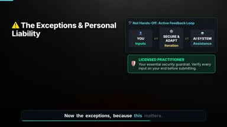 |
| 02:06.50 (s06-exceptions +2.50s) | `#head`, `#gfx-panel div`, `#gfx-panel span`, `#gfx-panel span`, `#gfx-panel span`, `#gfx-panel span`, `#gfx-panel span`, `#gfx-panel span`, `#guardrail-card div.guardrail-title`, `#guardrail-card div.guardrail-sub`, `#c1` | 35: "⚠️ The Exceptions & Personal Liability / 🛠️ Not Hands-Off: Active Feedback Loop / YOU / Inputs / SECURE & ADAPT / Iteration / AI SYSTEM / A" | 35 words, 14 lines, 4 text elements, font 28px | 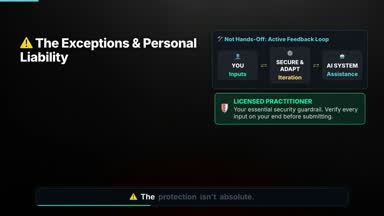 |
| 02:08.00 (s06-exceptions +4.00s) | `#head`, `#gfx-panel div`, `#gfx-panel span`, `#gfx-panel span`, `#gfx-panel span`, `#gfx-panel span`, `#gfx-panel span`, `#gfx-panel span`, `#guardrail-card div.guardrail-title`, `#guardrail-card div.guardrail-sub`, `#c2` | 37: "⚠️ The Exceptions & Personal Liability / 🛠️ Not Hands-Off: Active Feedback Loop / YOU / Inputs / SECURE & ADAPT / Iteration / AI SYSTEM / A" | 37 words, 14 lines, 4 text elements, font 28px |  |
| 02:10.00 (s06-exceptions +6.00s) | `#head`, `#gfx-panel div`, `#gfx-panel span`, `#gfx-panel span`, `#gfx-panel span`, `#gfx-panel span`, `#gfx-panel span`, `#gfx-panel span`, `#guardrail-card div.guardrail-title`, `#guardrail-card div.guardrail-sub` | 31: "⚠️ The Exceptions & Personal Liability / 🛠️ Not Hands-Off: Active Feedback Loop / YOU / Inputs / SECURE & ADAPT / Iteration / AI SYSTEM / A" | 31 words, 13 lines, 3 text elements, font 28px | 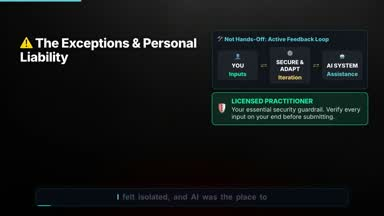 |
| 02:10.25 (s06-exceptions +6.25s) | `#head`, `#gfx-panel div`, `#gfx-panel span`, `#gfx-panel span`, `#gfx-panel span`, `#gfx-panel span`, `#gfx-panel span`, `#gfx-panel span`, `#guardrail-card div.guardrail-title`, `#guardrail-card div.guardrail-sub`, `#c3` | 40: "⚠️ The Exceptions & Personal Liability / 🛠️ Not Hands-Off: Active Feedback Loop / YOU / Inputs / SECURE & ADAPT / Iteration / AI SYSTEM / A" | 40 words, 14 lines, 4 text elements, font 28px | 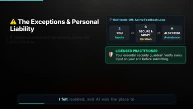 |
| 02:10.75 (s06-exceptions +6.75s) | `#head`, `#l0`, `#gfx-panel div`, `#gfx-panel span`, `#gfx-panel span`, `#gfx-panel span`, `#gfx-panel span`, `#gfx-panel span`, `#gfx-panel span`, `#guardrail-card div.guardrail-title`, `#guardrail-card div.guardrail-sub`, `#c3` | 51: "⚠️ The Exceptions & Personal Liability / 💡 Stopped accountant & felt isolated: AI was the place to turn to / 🛠️ Not Hands-Off: Active Feed" | 51 words, 16 lines, 5 text elements, font 28px | 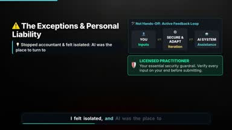 |
| 02:13.25 (s06-exceptions +9.25s) | `#head`, `#l0`, `#gfx-panel div`, `#gfx-panel span`, `#gfx-panel span`, `#gfx-panel span`, `#gfx-panel span`, `#gfx-panel span`, `#gfx-panel span`, `#guardrail-card div.guardrail-title`, `#guardrail-card div.guardrail-sub`, `#c4` | 51: "⚠️ The Exceptions & Personal Liability / 💡 Stopped accountant & felt isolated: AI was the place to turn to / 🛠️ Not Hands-Off: Active Feed" | 51 words, 16 lines, 5 text elements, font 28px | 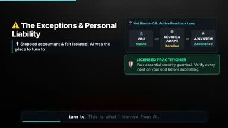 |
| 02:14.75 (s06-exceptions +10.75s) | `#head`, `#l0`, `#l1`, `#gfx-panel div`, `#gfx-panel span`, `#gfx-panel span`, `#gfx-panel span`, `#gfx-panel span`, `#gfx-panel span`, `#gfx-panel span`, `#guardrail-card div.guardrail-title`, `#guardrail-card div.guardrail-sub`, `#c4` | 61: "⚠️ The Exceptions & Personal Liability / 💡 Stopped accountant & felt isolated: AI was the place to turn to / 🛠️ Not hands-off: you are han" | 61 words, 18 lines, 6 text elements, font 28px | 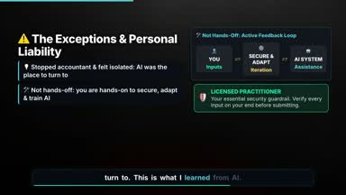 |
| 02:16.25 (s06-exceptions +12.25s) | `#head`, `#l0`, `#l1`, `#gfx-panel div`, `#gfx-panel span`, `#gfx-panel span`, `#gfx-panel span`, `#gfx-panel span`, `#gfx-panel span`, `#gfx-panel span`, `#guardrail-card div.guardrail-title`, `#guardrail-card div.guardrail-sub`, `#c5` | 61: "⚠️ The Exceptions & Personal Liability / 💡 Stopped accountant & felt isolated: AI was the place to turn to / 🛠️ Not hands-off: you are han" | 61 words, 18 lines, 6 text elements, font 28px | 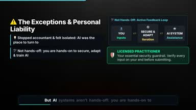 |
| 02:18.75 (s06-exceptions +14.75s) | `#head`, `#l0`, `#l1`, `#l2`, `#gfx-panel div`, `#gfx-panel span`, `#gfx-panel span`, `#gfx-panel span`, `#gfx-panel span`, `#gfx-panel span`, `#gfx-panel span`, `#guardrail-card div.guardrail-title`, `#guardrail-card div.guardrail-sub`, `#c5` | 66: "⚠️ The Exceptions & Personal Liability / 💡 Stopped accountant & felt isolated: AI was the place to turn to / 🛠️ Not hands-off: you are han" | 66 words, 19 lines, 7 text elements, font 28px | 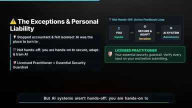 |
| 02:19.25 (s06-exceptions +15.25s) | `#head`, `#l0`, `#l1`, `#l2`, `#gfx-panel div`, `#gfx-panel span`, `#gfx-panel span`, `#gfx-panel span`, `#gfx-panel span`, `#gfx-panel span`, `#gfx-panel span`, `#guardrail-card div.guardrail-title`, `#guardrail-card div.guardrail-sub`, `#c6` | 62: "⚠️ The Exceptions & Personal Liability / 💡 Stopped accountant & felt isolated: AI was the place to turn to / 🛠️ Not hands-off: you are han" | 62 words, 19 lines, 7 text elements, font 28px | 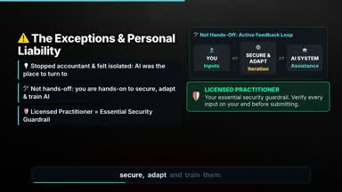 |
| 02:21.00 (s06-exceptions +17.00s) | `#head`, `#l0`, `#l1`, `#l2`, `#gfx-panel div`, `#gfx-panel span`, `#gfx-panel span`, `#gfx-panel span`, `#gfx-panel span`, `#gfx-panel span`, `#gfx-panel span`, `#guardrail-card div.guardrail-title`, `#guardrail-card div.guardrail-sub`, `#c7` | 64: "⚠️ The Exceptions & Personal Liability / 💡 Stopped accountant & felt isolated: AI was the place to turn to / 🛠️ Not hands-off: you are han" | 64 words, 19 lines, 7 text elements, font 28px | 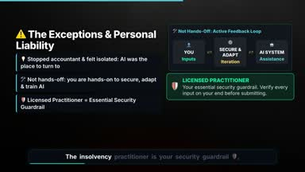 |
| 02:22.75 (s06-exceptions +18.75s) | `#head`, `#l0`, `#l1`, `#l2`, `#l3`, `#gfx-panel div`, `#gfx-panel span`, `#gfx-panel span`, `#gfx-panel span`, `#gfx-panel span`, `#gfx-panel span`, `#gfx-panel span`, `#guardrail-card div.guardrail-title`, `#guardrail-card div.guardrail-sub`, `#c7` | 71: "⚠️ The Exceptions & Personal Liability / 💡 Stopped accountant & felt isolated: AI was the place to turn to / 🛠️ Not hands-off: you are han" | 71 words, 21 lines, list, 8 text elements, font 28px | 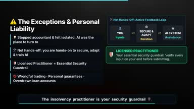 |
| 02:23.50 (s06-exceptions +19.50s) | `#head`, `#l0`, `#l1`, `#l2`, `#l3`, `#gfx-panel div`, `#gfx-panel span`, `#gfx-panel span`, `#gfx-panel span`, `#gfx-panel span`, `#gfx-panel span`, `#gfx-panel span`, `#guardrail-card div.guardrail-title`, `#guardrail-card div.guardrail-sub` | 64: "⚠️ The Exceptions & Personal Liability / 💡 Stopped accountant & felt isolated: AI was the place to turn to / 🛠️ Not hands-off: you are han" | 64 words, 20 lines, list, 7 text elements, font 28px | 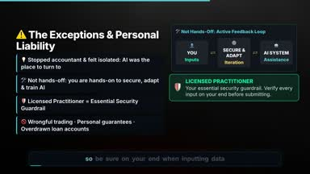 |
| 02:23.75 (s06-exceptions +19.75s) | `#head`, `#l0`, `#l1`, `#l2`, `#l3`, `#gfx-panel div`, `#gfx-panel span`, `#gfx-panel span`, `#gfx-panel span`, `#gfx-panel span`, `#gfx-panel span`, `#gfx-panel span`, `#guardrail-card div.guardrail-title`, `#guardrail-card div.guardrail-sub`, `#c8` | 73: "⚠️ The Exceptions & Personal Liability / 💡 Stopped accountant & felt isolated: AI was the place to turn to / 🛠️ Not hands-off: you are han" | 73 words, 21 lines, list, 8 text elements, font 28px | 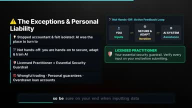 |
| 02:26.75 (s06-exceptions +22.75s) | `#head`, `#l0`, `#l1`, `#l2`, `#l3`, `#gfx-panel div`, `#gfx-panel span`, `#gfx-panel span`, `#gfx-panel span`, `#gfx-panel span`, `#gfx-panel span`, `#gfx-panel span`, `#guardrail-card div.guardrail-title`, `#guardrail-card div.guardrail-sub`, `#c9` | 72: "⚠️ The Exceptions & Personal Liability / 💡 Stopped accountant & felt isolated: AI was the place to turn to / 🛠️ Not hands-off: you are han" | 72 words, 21 lines, list, 8 text elements, font 28px | 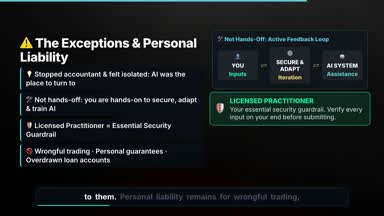 |
| 02:29.25 (s06-exceptions +25.25s) | `#head`, `#l0`, `#l1`, `#l2`, `#l3`, `#gfx-panel div`, `#gfx-panel span`, `#gfx-panel span`, `#gfx-panel span`, `#gfx-panel span`, `#gfx-panel span`, `#gfx-panel span`, `#guardrail-card div.guardrail-title`, `#guardrail-card div.guardrail-sub` | 64: "⚠️ The Exceptions & Personal Liability / 💡 Stopped accountant & felt isolated: AI was the place to turn to / 🛠️ Not hands-off: you are han" | 64 words, 20 lines, list, 7 text elements, font 28px | 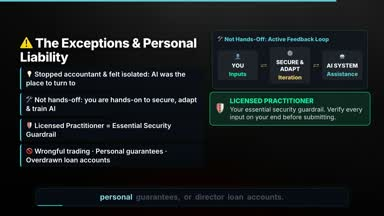 |
| 02:29.50 (s06-exceptions +25.50s) | `#head`, `#l0`, `#l1`, `#l2`, `#l3`, `#gfx-panel div`, `#gfx-panel span`, `#gfx-panel span`, `#gfx-panel span`, `#gfx-panel span`, `#gfx-panel span`, `#gfx-panel span`, `#guardrail-card div.guardrail-title`, `#guardrail-card div.guardrail-sub`, `#c10` | 70: "⚠️ The Exceptions & Personal Liability / 💡 Stopped accountant & felt isolated: AI was the place to turn to / 🛠️ Not hands-off: you are han" | 70 words, 21 lines, list, 8 text elements, font 28px | 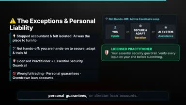 |
| 02:31.25 (s06-exceptions +27.25s) | `#head`, `#l0`, `#l1`, `#l2`, `#l3`, `#gfx-panel div`, `#gfx-panel span`, `#gfx-panel span`, `#gfx-panel span`, `#gfx-panel span`, `#gfx-panel span`, `#gfx-panel span`, `#guardrail-card div.guardrail-title`, `#guardrail-card div.guardrail-sub` | 64: "⚠️ The Exceptions & Personal Liability / 💡 Stopped accountant & felt isolated: AI was the place to turn to / 🛠️ Not hands-off: you are han" | 64 words, 20 lines, list, 7 text elements, font 28px | 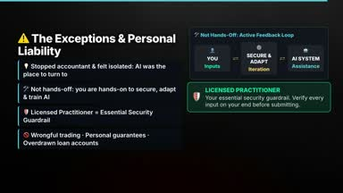 |
| 02:33.50 (s07-emails +0.50s) | `#head`, `#c0` | 11: "📧 Lessons from Emails & Records / Three lessons from my emails and records." | 11 words, 3 lines, 2 text elements, font 38px |  |
| 02:34.25 (s07-emails +1.25s) | `#head`, `#gfx-panel span`, `#gfx-panel div.mcp-pill`, `#c0` | 22: "📧 Lessons from Emails & Records / Online Records = Structured Database / ⚡ Connect Drive & Gmail over MCP to AI / Three lessons from my ema" | 22 words, 5 lines, 4 text elements, font 28px |  |
| 02:35.25 (s07-emails +2.25s) | `#head`, `#gfx-panel span`, `#gfx-panel span`, `#gfx-panel span`, `#gfx-panel div.mcp-pill`, `#c0` | 28: "📧 Lessons from Emails & Records / Online Records = Structured Database / Chaser Emails / 6 Reminders (Action Required) / ⚡ Connect Drive & " | 28 words, 7 lines, 5 text elements, font 28px |  |
| 02:35.75 (s07-emails +2.75s) | `#head`, `#gfx-panel span`, `#gfx-panel span`, `#gfx-panel span`, `#gfx-panel span`, `#gfx-panel span`, `#gfx-panel div.mcp-pill`, `#c0` | 32: "📧 Lessons from Emails & Records / Online Records = Structured Database / Chaser Emails / 6 Reminders (Action Required) / Receipts & Slips /" | 32 words, 9 lines, 5 text elements, font 28px |  |
| 02:36.00 (s07-emails +3.00s) | `#head`, `#gfx-panel span`, `#gfx-panel span`, `#gfx-panel span`, `#gfx-panel span`, `#gfx-panel span`, `#gfx-panel div.mcp-pill`, `#c1` | 34: "📧 Lessons from Emails & Records / Online Records = Structured Database / Chaser Emails / 6 Reminders (Action Required) / Receipts & Slips /" | 34 words, 9 lines, 5 text elements, font 28px |  |
| 02:36.25 (s07-emails +3.25s) | `#head`, `#gfx-panel span`, `#gfx-panel span`, `#gfx-panel span`, `#gfx-panel span`, `#gfx-panel span`, `#gfx-panel span`, `#gfx-panel span`, `#gfx-panel div.mcp-pill`, `#c1` | 39: "📧 Lessons from Emails & Records / Online Records = Structured Database / Chaser Emails / 6 Reminders (Action Required) / Receipts & Slips /" | 39 words, 11 lines, 6 text elements, font 28px |  |
| 02:38.75 (s07-emails +5.75s) | `#head`, `#l0`, `#gfx-panel span`, `#gfx-panel span`, `#gfx-panel span`, `#gfx-panel span`, `#gfx-panel span`, `#gfx-panel span`, `#gfx-panel span`, `#gfx-panel div.mcp-pill`, `#c1` | 51: "📧 Lessons from Emails & Records / 1️⃣ Process starts once balance is paid in full (chased 6 times ⏳) / Online Records = Structured Database" | 51 words, 13 lines, list, 7 text elements, font 28px | 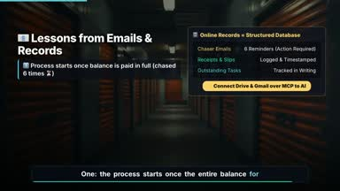 |
| 02:39.50 (s07-emails +6.50s) | `#head`, `#l0`, `#gfx-panel span`, `#gfx-panel span`, `#gfx-panel span`, `#gfx-panel span`, `#gfx-panel span`, `#gfx-panel span`, `#gfx-panel span`, `#gfx-panel div.mcp-pill`, `#c2` | 51: "📧 Lessons from Emails & Records / 1️⃣ Process starts once balance is paid in full (chased 6 times ⏳) / Online Records = Structured Database" | 51 words, 13 lines, list, 7 text elements, font 28px |  |
| 02:42.25 (s07-emails +9.25s) | `#head`, `#l0`, `#l1`, `#gfx-panel span`, `#gfx-panel span`, `#gfx-panel span`, `#gfx-panel span`, `#gfx-panel span`, `#gfx-panel span`, `#gfx-panel span`, `#gfx-panel div.mcp-pill`, `#c2` | 60: "📧 Lessons from Emails & Records / 1️⃣ Process starts once balance is paid in full (chased 6 times ⏳) / 2️⃣ Use online methods: they act as " | 60 words, 15 lines, list, 8 text elements, font 28px |  |
| 02:42.75 (s07-emails +9.75s) | `#head`, `#l0`, `#l1`, `#gfx-panel span`, `#gfx-panel span`, `#gfx-panel span`, `#gfx-panel span`, `#gfx-panel span`, `#gfx-panel span`, `#gfx-panel span`, `#gfx-panel div.mcp-pill` | 51: "📧 Lessons from Emails & Records / 1️⃣ Process starts once balance is paid in full (chased 6 times ⏳) / 2️⃣ Use online methods: they act as " | 51 words, 14 lines, list, 7 text elements, font 28px | 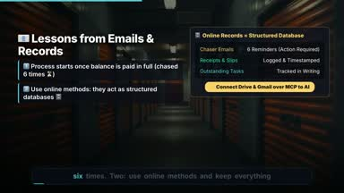 |
| 02:43.00 (s07-emails +10.00s) | `#head`, `#l0`, `#l1`, `#gfx-panel span`, `#gfx-panel span`, `#gfx-panel span`, `#gfx-panel span`, `#gfx-panel span`, `#gfx-panel span`, `#gfx-panel span`, `#gfx-panel div.mcp-pill`, `#c3` | 60: "📧 Lessons from Emails & Records / 1️⃣ Process starts once balance is paid in full (chased 6 times ⏳) / 2️⃣ Use online methods: they act as " | 60 words, 15 lines, list, 8 text elements, font 28px | 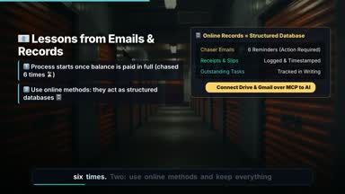 |
| 02:45.75 (s07-emails +12.75s) | `#head`, `#l0`, `#l1`, `#l2`, `#gfx-panel span`, `#gfx-panel span`, `#gfx-panel span`, `#gfx-panel span`, `#gfx-panel span`, `#gfx-panel span`, `#gfx-panel span`, `#gfx-panel div.mcp-pill`, `#c3` | 68: "📧 Lessons from Emails & Records / 1️⃣ Process starts once balance is paid in full (chased 6 times ⏳) / 2️⃣ Use online methods: they act as " | 68 words, 16 lines, list, 9 text elements, font 28px | 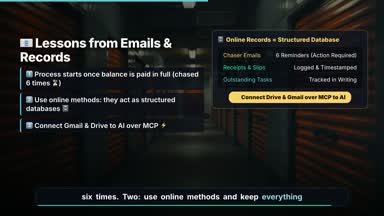 |
| 02:46.25 (s07-emails +13.25s) | `#head`, `#l0`, `#l1`, `#l2`, `#gfx-panel span`, `#gfx-panel span`, `#gfx-panel span`, `#gfx-panel span`, `#gfx-panel span`, `#gfx-panel span`, `#gfx-panel span`, `#gfx-panel div.mcp-pill`, `#c4` | 67: "📧 Lessons from Emails & Records / 1️⃣ Process starts once balance is paid in full (chased 6 times ⏳) / 2️⃣ Use online methods: they act as " | 67 words, 16 lines, list, 9 text elements, font 28px | 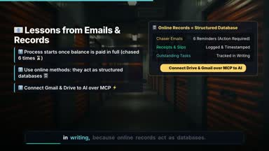 |
| 02:49.25 (s07-emails +16.25s) | `#head`, `#l0`, `#l1`, `#l2`, `#l3`, `#gfx-panel span`, `#gfx-panel span`, `#gfx-panel span`, `#gfx-panel span`, `#gfx-panel span`, `#gfx-panel span`, `#gfx-panel span`, `#gfx-panel div.mcp-pill`, `#c5` | 66: "📧 Lessons from Emails & Records / 1️⃣ Process starts once balance is paid in full (chased 6 times ⏳) / 2️⃣ Use online methods: they act as " | 66 words, 17 lines, list, 9 text elements, font 28px | 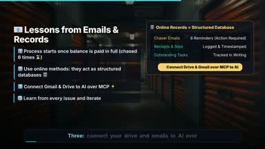 |
| 02:49.50 (s07-emails +16.50s) | `#head`, `#l0`, `#l1`, `#l2`, `#l3`, `#gfx-panel span`, `#gfx-panel span`, `#gfx-panel span`, `#gfx-panel span`, `#gfx-panel span`, `#gfx-panel span`, `#gfx-panel span`, `#gfx-panel div.mcp-pill`, `#c5` | 74: "📧 Lessons from Emails & Records / 1️⃣ Process starts once balance is paid in full (chased 6 times ⏳) / 2️⃣ Use online methods: they act as " | 74 words, 17 lines, list, 10 text elements, font 28px | 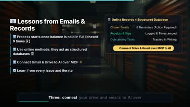 |
| 02:52.75 (s07-emails +19.75s) | `#head`, `#l0`, `#l1`, `#l2`, `#l3`, `#gfx-panel span`, `#gfx-panel span`, `#gfx-panel span`, `#gfx-panel span`, `#gfx-panel span`, `#gfx-panel span`, `#gfx-panel span`, `#gfx-panel div.mcp-pill`, `#c6` | 75: "📧 Lessons from Emails & Records / 1️⃣ Process starts once balance is paid in full (chased 6 times ⏳) / 2️⃣ Use online methods: they act as " | 75 words, 17 lines, list, 10 text elements, font 28px |  |
| 02:56.50 (s07-emails +23.50s) | `#head`, `#l0`, `#l1`, `#l2`, `#l3`, `#gfx-panel span`, `#gfx-panel span`, `#gfx-panel span`, `#gfx-panel span`, `#gfx-panel span`, `#gfx-panel span`, `#gfx-panel span`, `#gfx-panel div.mcp-pill` | 65: "📧 Lessons from Emails & Records / 1️⃣ Process starts once balance is paid in full (chased 6 times ⏳) / 2️⃣ Use online methods: they act as " | 65 words, 16 lines, list, 9 text elements, font 28px | 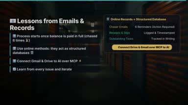 |
| 02:57.50 (s08-tracking +0.50s) | `#head`, `#c0` | 17: "⚙️ n8n (Scheduled Email) vs 🧠 AI Bot (Unknown Replies) / I keep track of it all with n8n and" | 17 words, 3 lines, 2 text elements, font 38px |  |
| 02:58.25 (s08-tracking +1.25s) | `#head`, `#gfx-panel div.wf-title`, `#gfx-panel div.wf-node`, `#gfx-panel div.wf-node`, `#gfx-panel div.wf-title`, `#gfx-panel div.wf-node`, `#gfx-panel div.wf-node`, `#c0` | 38: "⚙️ n8n (Scheduled Email) vs 🧠 AI Bot (Unknown Replies) / ⚙️ n8n (Deterministic): Scheduled Email / ⏰ Mon 09:00 Cron / ✉️ Send Requests & Re" | 38 words, 12 lines, 8 text elements, font 28px |  |
| 03:00.75 (s08-tracking +3.75s) | `#head`, `#gfx-panel div.wf-title`, `#gfx-panel div.wf-node`, `#gfx-panel div.wf-node`, `#gfx-panel div.wf-title`, `#gfx-panel div.wf-node`, `#gfx-panel div.wf-node` | 29: "⚙️ n8n (Scheduled Email) vs 🧠 AI Bot (Unknown Replies) / ⚙️ n8n (Deterministic): Scheduled Email / ⏰ Mon 09:00 Cron / ✉️ Send Requests & Re" | 29 words, 11 lines, 7 text elements, font 28px |  |
| 03:01.00 (s08-tracking +4.00s) | `#head`, `#gfx-panel div.wf-title`, `#gfx-panel div.wf-node`, `#gfx-panel div.wf-node`, `#gfx-panel div.wf-title`, `#gfx-panel div.wf-node`, `#gfx-panel div.wf-node`, `#c1` | 37: "⚙️ n8n (Scheduled Email) vs 🧠 AI Bot (Unknown Replies) / ⚙️ n8n (Deterministic): Scheduled Email / ⏰ Mon 09:00 Cron / ✉️ Send Requests & Re" | 37 words, 12 lines, 8 text elements, font 28px |  |
| 03:04.00 (s08-tracking +7.00s) | `#head`, `#gfx-panel div.wf-title`, `#gfx-panel div.wf-node`, `#gfx-panel div.wf-node`, `#gfx-panel div.wf-title`, `#gfx-panel div.wf-node`, `#gfx-panel div.wf-node`, `#c2` | 35: "⚙️ n8n (Scheduled Email) vs 🧠 AI Bot (Unknown Replies) / ⚙️ n8n (Deterministic): Scheduled Email / ⏰ Mon 09:00 Cron / ✉️ Send Requests & Re" | 35 words, 12 lines, 8 text elements, font 28px |  |
| 03:04.25 (s08-tracking +7.25s) | `#head`, `#l0`, `#gfx-panel div.wf-title`, `#gfx-panel div.wf-node`, `#gfx-panel div.wf-node`, `#gfx-panel div.wf-title`, `#gfx-panel div.wf-node`, `#gfx-panel div.wf-node`, `#c2` | 41: "⚙️ n8n (Scheduled Email) vs 🧠 AI Bot (Unknown Replies) / 🏗️ Build your workflow process around both / ⚙️ n8n (Deterministic): Scheduled Em" | 41 words, 13 lines, 9 text elements, font 28px |  |
| 03:06.25 (s08-tracking +9.25s) | `#head`, `#l0`, `#gfx-panel div.wf-title`, `#gfx-panel div.wf-node`, `#gfx-panel div.wf-node`, `#gfx-panel div.wf-title`, `#gfx-panel div.wf-node`, `#gfx-panel div.wf-node` | 35: "⚙️ n8n (Scheduled Email) vs 🧠 AI Bot (Unknown Replies) / 🏗️ Build your workflow process around both / ⚙️ n8n (Deterministic): Scheduled Em" | 35 words, 12 lines, 8 text elements, font 28px |  |
| 03:06.50 (s08-tracking +9.50s) | `#head`, `#l0`, `#gfx-panel div.wf-title`, `#gfx-panel div.wf-node`, `#gfx-panel div.wf-node`, `#gfx-panel div.wf-title`, `#gfx-panel div.wf-node`, `#gfx-panel div.wf-node`, `#c3` | 40: "⚙️ n8n (Scheduled Email) vs 🧠 AI Bot (Unknown Replies) / 🏗️ Build your workflow process around both / ⚙️ n8n (Deterministic): Scheduled Em" | 40 words, 13 lines, 9 text elements, font 28px |  |
| 03:06.75 (s08-tracking +9.75s) | `#head`, `#l0`, `#c3` | 19: "⚙️ n8n (Scheduled Email) vs 🧠 AI Bot (Unknown Replies) / 🏗️ Build your workflow process around both / Build your process around both." | 19 words, 4 lines, 3 text elements, font 34px |  |
| 03:07.00 (s08-tracking +10.00s) | `#head`, `#l0`, `#friend-card span`, `#friend-card span.honour-badge`, `#friend-card div.friend-quote`, `#friend-card strong`, `#friend-card div`, `#c3` | 56: "⚙️ n8n (Scheduled Email) vs 🧠 AI Bot (Unknown Replies) / 🏗️ Build your workflow process around both / 🏔️ THE HERO'S JOURNEY / TRUTH OVER " | 56 words, 9 lines, list, 8 text elements, font 28px |  |
| 03:08.25 (s08-tracking +11.25s) | `#head`, `#l0`, `#friend-card span`, `#friend-card span.honour-badge`, `#friend-card div.friend-quote`, `#friend-card strong`, `#friend-card div`, `#c4` | 58: "⚙️ n8n (Scheduled Email) vs 🧠 AI Bot (Unknown Replies) / 🏗️ Build your workflow process around both / 🏔️ THE HERO'S JOURNEY / TRUTH OVER " | 58 words, 9 lines, list, 8 text elements, font 28px |  |
| 03:09.25 (s08-tracking +12.25s) | `#head`, `#l0`, `#l1`, `#friend-card span`, `#friend-card span.honour-badge`, `#friend-card div.friend-quote`, `#friend-card strong`, `#friend-card div`, `#c4` | 67: "⚙️ n8n (Scheduled Email) vs 🧠 AI Bot (Unknown Replies) / 🏗️ Build your workflow process around both / 🏔️ Hero's Journey: Have the honour " | 67 words, 10 lines, list, 9 text elements, font 28px |  |
| 03:11.00 (s08-tracking +14.00s) | `#head`, `#l0`, `#l1`, `#friend-card span`, `#friend-card span.honour-badge`, `#friend-card div.friend-quote`, `#friend-card strong`, `#friend-card div`, `#c5` | 65: "⚙️ n8n (Scheduled Email) vs 🧠 AI Bot (Unknown Replies) / 🏗️ Build your workflow process around both / 🏔️ Hero's Journey: Have the honour " | 65 words, 10 lines, list, 9 text elements, font 28px |  |
| 03:13.00 (s08-tracking +16.00s) | `#head`, `#l0`, `#l1`, `#friend-card span`, `#friend-card span.honour-badge`, `#friend-card div.friend-quote`, `#friend-card strong`, `#friend-card div`, `#c6` | 69: "⚙️ n8n (Scheduled Email) vs 🧠 AI Bot (Unknown Replies) / 🏗️ Build your workflow process around both / 🏔️ Hero's Journey: Have the honour " | 69 words, 10 lines, list, 9 text elements, font 28px |  |
| 03:14.25 (s08-tracking +17.25s) | `#head`, `#l0`, `#l1`, `#l2`, `#friend-card span`, `#friend-card span.honour-badge`, `#friend-card div.friend-quote`, `#friend-card strong`, `#friend-card div`, `#c6` | 77: "⚙️ n8n (Scheduled Email) vs 🧠 AI Bot (Unknown Replies) / 🏗️ Build your workflow process around both / 🏔️ Hero's Journey: Have the honour " | 77 words, 11 lines, list, 10 text elements, font 28px |  |
| 03:16.50 (s08-tracking +19.50s) | `#head`, `#l0`, `#l1`, `#l2`, `#friend-card span`, `#friend-card span.honour-badge`, `#friend-card div.friend-quote`, `#friend-card strong`, `#friend-card div`, `#c7` | 73: "⚙️ n8n (Scheduled Email) vs 🧠 AI Bot (Unknown Replies) / 🏗️ Build your workflow process around both / 🏔️ Hero's Journey: Have the honour " | 73 words, 11 lines, list, 10 text elements, font 28px |  |
| 03:18.50 (s08-tracking +21.50s) | `#head`, `#l0`, `#l1`, `#l2`, `#friend-card span`, `#friend-card span.honour-badge`, `#friend-card div.friend-quote`, `#friend-card strong`, `#friend-card div`, `#c8` | 77: "⚙️ n8n (Scheduled Email) vs 🧠 AI Bot (Unknown Replies) / 🏗️ Build your workflow process around both / 🏔️ Hero's Journey: Have the honour " | 77 words, 11 lines, list, 10 text elements, font 28px |  |
| 03:21.75 (s08-tracking +24.75s) | `#friend-card span`, `#friend-card span.honour-badge`, `#friend-card div.friend-quote`, `#friend-card strong`, `#friend-card div` | 37: "🏔️ THE HERO'S JOURNEY / TRUTH OVER HYPE / “A friend told me: become like MrBeast, why show your real work? / ✨ Have the honour to do what's" | 37 words, 5 lines, list, 5 text elements, font 28px |  |
| 03:22.50 (s09-cta +0.50s) | `#head`, `#c0` | 18: "🌟 From Shame to Grace: Don't attach your identity to a company / Closing a company often carries personal shame," | 18 words, 4 lines, 2 text elements, font 38px |  |
| 03:23.00 (s09-cta +1.00s) | `#head`, `#gfx-panel div`, `#gfx-panel div`, `#gfx-panel div`, `#gfx-panel div.comments-prompt`, `#sub-btn`, `#c0` | 54: "🌟 From Shame to Grace: Don't attach your identity to a company / 🌅 From Shame to Grace / A company is merely a legal vehicle. Do not attac" | 54 words, 11 lines, 6 text elements, font 28px |  |
| 03:24.50 (s09-cta +2.50s) | `#head`, `#gfx-panel div`, `#gfx-panel div`, `#gfx-panel div`, `#gfx-panel div.comments-prompt`, `#sub-btn`, `#c1` | 56: "🌟 From Shame to Grace: Don't attach your identity to a company / 🌅 From Shame to Grace / A company is merely a legal vehicle. Do not attac" | 56 words, 11 lines, 6 text elements, font 28px |  |
| 03:27.25 (s09-cta +5.25s) | `#head`, `#gfx-panel div`, `#gfx-panel div`, `#gfx-panel div`, `#gfx-panel div.comments-prompt`, `#sub-btn`, `#c2` | 55: "🌟 From Shame to Grace: Don't attach your identity to a company / 🌅 From Shame to Grace / A company is merely a legal vehicle. Do not attac" | 55 words, 11 lines, 6 text elements, font 28px |  |
| 03:28.50 (s09-cta +6.50s) | `#head`, `#l0`, `#gfx-panel div`, `#gfx-panel div`, `#gfx-panel div`, `#gfx-panel div.comments-prompt`, `#sub-btn`, `#c2` | 65: "🌟 From Shame to Grace: Don't attach your identity to a company / 🚗 A company is just a vehicle · You can always restart 🔄 / 🌅 From Shame" | 65 words, 12 lines, list, 7 text elements, font 28px |  |
| 03:29.75 (s09-cta +7.75s) | `#head`, `#l0`, `#gfx-panel div`, `#gfx-panel div`, `#gfx-panel div`, `#gfx-panel div.comments-prompt`, `#sub-btn`, `#c3` | 66: "🌟 From Shame to Grace: Don't attach your identity to a company / 🚗 A company is just a vehicle · You can always restart 🔄 / 🌅 From Shame" | 66 words, 12 lines, list, 7 text elements, font 28px |  |
| 03:32.50 (s09-cta +10.50s) | `#head`, `#l0`, `#gfx-panel div`, `#gfx-panel div`, `#gfx-panel div`, `#gfx-panel div.comments-prompt`, `#sub-btn`, `#c4` | 66: "🌟 From Shame to Grace: Don't attach your identity to a company / 🚗 A company is just a vehicle · You can always restart 🔄 / 🌅 From Shame" | 66 words, 12 lines, list, 7 text elements, font 28px |  |
| 03:32.75 (s09-cta +10.75s) | `#head`, `#l0`, `#l1`, `#gfx-panel div`, `#gfx-panel div`, `#gfx-panel div`, `#gfx-panel div.comments-prompt`, `#sub-btn`, `#c4` | 79: "🌟 From Shame to Grace: Don't attach your identity to a company / 🚗 A company is just a vehicle · You can always restart 🔄 / 🔔 Subscribe " | 79 words, 14 lines, list, 8 text elements, font 28px |  |
| 03:35.25 (s09-cta +13.25s) | `#head`, `#l0`, `#l1`, `#gfx-panel div`, `#gfx-panel div`, `#gfx-panel div`, `#gfx-panel div.comments-prompt`, `#sub-btn`, `#c5` | 74: "🌟 From Shame to Grace: Don't attach your identity to a company / 🚗 A company is just a vehicle · You can always restart 🔄 / 🔔 Subscribe " | 74 words, 14 lines, list, 8 text elements, font 28px |  |
| 03:36.50 (s09-cta +14.50s) | `#head`, `#l0`, `#l1`, `#gfx-panel div`, `#gfx-panel div`, `#gfx-panel div`, `#gfx-panel div.comments-prompt`, `#sub-btn`, `#c6` | 79: "🌟 From Shame to Grace: Don't attach your identity to a company / 🚗 A company is just a vehicle · You can always restart 🔄 / 🔔 Subscribe " | 79 words, 14 lines, list, 8 text elements, font 28px |  |
| 03:37.00 (s09-cta +15.00s) | `#head`, `#l0`, `#l1`, `#l2`, `#gfx-panel div`, `#gfx-panel div`, `#gfx-panel div`, `#gfx-panel div.comments-prompt`, `#sub-btn`, `#c6` | 84: "🌟 From Shame to Grace: Don't attach your identity to a company / 🚗 A company is just a vehicle · You can always restart 🔄 / 🔔 Subscribe " | 84 words, 15 lines, list, 9 text elements, font 28px |  |
| 03:39.25 (s09-cta +17.25s) | `#head`, `#l0`, `#l1`, `#l2`, `#gfx-panel div`, `#gfx-panel div`, `#gfx-panel div`, `#gfx-panel div.comments-prompt`, `#sub-btn`, `#c7` | 84: "🌟 From Shame to Grace: Don't attach your identity to a company / 🚗 A company is just a vehicle · You can always restart 🔄 / 🔔 Subscribe " | 84 words, 15 lines, list, 9 text elements, font 28px |  |
| 03:42.00 (s09-cta +20.00s) | `#head`, `#l0`, `#l1`, `#l2`, `#gfx-panel div`, `#gfx-panel div`, `#gfx-panel div`, `#gfx-panel div.comments-prompt`, `#sub-btn` | 75: "🌟 From Shame to Grace: Don't attach your identity to a company / 🚗 A company is just a vehicle · You can always restart 🔄 / 🔔 Subscribe " | 75 words, 14 lines, list, 8 text elements, font 28px |  |
| 03:42.25 (s09-cta +20.25s) | `#head`, `#l0`, `#l1`, `#l2`, `#gfx-panel div`, `#gfx-panel div`, `#gfx-panel div`, `#gfx-panel div.comments-prompt`, `#sub-btn`, `#c8` | 82: "🌟 From Shame to Grace: Don't attach your identity to a company / 🚗 A company is just a vehicle · You can always restart 🔄 / 🔔 Subscribe " | 82 words, 15 lines, list, 9 text elements, font 28px |  |
| 03:44.25 (s09-cta +22.25s) | `#head`, `#l0`, `#l1`, `#l2`, `#gfx-panel div`, `#gfx-panel div`, `#gfx-panel div`, `#gfx-panel div.comments-prompt`, `#sub-btn` | 75: "🌟 From Shame to Grace: Don't attach your identity to a company / 🚗 A company is just a vehicle · You can always restart 🔄 / 🔔 Subscribe " | 75 words, 14 lines, list, 8 text elements, font 28px |  |
| 03:45.50 (s10-outro +0.50s) | `#head`, `#c0` | 12: "🤖 AI Bot prepares → ⚖️ Human practitioner decides / Important disclaimer: AI organises and explains," | 12 words, 3 lines, 2 text elements, font 38px |  |
| 03:45.75 (s10-outro +0.75s) | `#head`, `#gfx-panel div`, `#ho-bot span.ho-title`, `#ho-bot span.ho-desc`, `#ho-arrow span.ho-arrow-text`, `#ho-human span.ho-title`, `#ho-human span.ho-desc`, `#gfx-panel div.ho-guardrail`, `#skool-badge`, `#skool-panel div.skool-url`, `#c0` | 36: "🤖 AI Bot prepares → ⚖️ Human practitioner decides / 🤖 BOT TO HUMAN HANDOVER / AI BOT / Organises Data / STREAM / PRACTITIONER / Decides & " | 36 words, 13 lines, 5 text elements, font 28px |  |
| 03:47.75 (s10-outro +2.75s) | `#head`, `#gfx-panel div`, `#ho-bot span.ho-title`, `#ho-bot span.ho-desc`, `#ho-arrow span.ho-arrow-text`, `#ho-human span.ho-title`, `#ho-human span.ho-desc`, `#gfx-panel div.ho-guardrail`, `#skool-badge`, `#skool-panel div.skool-url`, `#c1` | 35: "🤖 AI Bot prepares → ⚖️ Human practitioner decides / 🤖 BOT TO HUMAN HANDOVER / AI BOT / Organises Data / STREAM / PRACTITIONER / Decides & " | 35 words, 13 lines, 5 text elements, font 28px |  |
| 03:49.75 (s10-outro +4.75s) | `#head`, `#gfx-panel div`, `#ho-bot span.ho-title`, `#ho-bot span.ho-desc`, `#ho-arrow span.ho-arrow-text`, `#ho-human span.ho-title`, `#ho-human span.ho-desc`, `#gfx-panel div.ho-guardrail`, `#skool-badge`, `#skool-panel div.skool-url` | 30: "🤖 AI Bot prepares → ⚖️ Human practitioner decides / 🤖 BOT TO HUMAN HANDOVER / AI BOT / Organises Data / STREAM / PRACTITIONER / Decides & " | 30 words, 12 lines, 4 text elements, font 28px |  |
| 03:50.00 (s10-outro +5.00s) | `#head`, `#l0`, `#gfx-panel div`, `#ho-bot span.ho-title`, `#ho-bot span.ho-desc`, `#ho-arrow span.ho-arrow-text`, `#ho-human span.ho-title`, `#ho-human span.ho-desc`, `#gfx-panel div.ho-guardrail`, `#skool-badge`, `#skool-panel div.skool-url`, `#c2` | 44: "🤖 AI Bot prepares → ⚖️ Human practitioner decides / ⚖️ DISCLAIMER: Informational only · Not legal/financial advice / 🤖 BOT TO HUMAN HANDOV" | 44 words, 15 lines, list, 6 text elements, font 28px |  |
| 03:53.25 (s10-outro +8.25s) | `#head`, `#l0`, `#gfx-panel div`, `#ho-bot span.ho-title`, `#ho-bot span.ho-desc`, `#ho-arrow span.ho-arrow-text`, `#ho-human span.ho-title`, `#ho-human span.ho-desc`, `#gfx-panel div.ho-guardrail`, `#skool-badge`, `#skool-panel div.skool-url`, `#c3` | 42: "🤖 AI Bot prepares → ⚖️ Human practitioner decides / ⚖️ DISCLAIMER: Informational only · Not legal/financial advice / 🤖 BOT TO HUMAN HANDOV" | 42 words, 15 lines, list, 6 text elements, font 28px |  |
| 03:53.50 (s10-outro +8.50s) | `#head`, `#l0`, `#l1`, `#gfx-panel div`, `#ho-bot span.ho-title`, `#ho-bot span.ho-desc`, `#ho-arrow span.ho-arrow-text`, `#ho-human span.ho-title`, `#ho-human span.ho-desc`, `#gfx-panel div.ho-guardrail`, `#skool-badge`, `#skool-panel div.skool-url`, `#c3` | 48: "🤖 AI Bot prepares → ⚖️ Human practitioner decides / ⚖️ DISCLAIMER: Informational only · Not legal/financial advice / 🚀 Join Delivery Pilot" | 48 words, 16 lines, list, 7 text elements, font 28px |  |
| 03:55.50 (s10-outro +10.50s) | `#head`, `#l0`, `#l1`, `#gfx-panel div`, `#ho-bot span.ho-title`, `#ho-bot span.ho-desc`, `#ho-arrow span.ho-arrow-text`, `#ho-human span.ho-title`, `#ho-human span.ho-desc`, `#gfx-panel div.ho-guardrail`, `#skool-badge`, `#skool-panel div.skool-url` | 42: "🤖 AI Bot prepares → ⚖️ Human practitioner decides / ⚖️ DISCLAIMER: Informational only · Not legal/financial advice / 🚀 Join Delivery Pilot" | 42 words, 15 lines, list, 6 text elements, font 28px |  |
| 03:55.75 (s10-outro +10.75s) | `#head`, `#l0`, `#l1`, `#gfx-panel div`, `#ho-bot span.ho-title`, `#ho-bot span.ho-desc`, `#ho-arrow span.ho-arrow-text`, `#ho-human span.ho-title`, `#ho-human span.ho-desc`, `#gfx-panel div.ho-guardrail`, `#skool-badge`, `#skool-panel div.skool-url`, `#c4` | 51: "🤖 AI Bot prepares → ⚖️ Human practitioner decides / ⚖️ DISCLAIMER: Informational only · Not legal/financial advice / 🚀 Join Delivery Pilot" | 51 words, 16 lines, list, 7 text elements, font 28px |  |
| 03:56.00 (s10-outro +11.00s) | `#head`, `#l0`, `#l1`, `#skool-badge`, `#skool-panel div.skool-url`, `#c4` | 31: "🤖 AI Bot prepares → ⚖️ Human practitioner decides / ⚖️ DISCLAIMER: Informational only · Not legal/financial advice / 🚀 Join Delivery Pilot" | 31 words, 8 lines, list, 5 text elements, font 28px |  |
| 03:57.25 (s10-outro +12.25s) | `#head`, `#l0`, `#l1`, `#l2`, `#skool-badge`, `#skool-panel div.skool-url`, `#c4` | 32: "🤖 AI Bot prepares → ⚖️ Human practitioner decides / ⚖️ DISCLAIMER: Informational only · Not legal/financial advice / 🚀 Join Delivery Pilot" | 32 words, 9 lines, list, 5 text elements, font 28px |  |
| 03:59.25 (s10-outro +14.25s) | `#head`, `#l0`, `#l1`, `#l2`, `#skool-badge`, `#skool-panel div.skool-url`, `#c5` | 31: "🤖 AI Bot prepares → ⚖️ Human practitioner decides / ⚖️ DISCLAIMER: Informational only · Not legal/financial advice / 🚀 Join Delivery Pilot" | 31 words, 9 lines, list, 5 text elements, font 28px |  |
| 04:02.50 (s10-outro +17.50s) | `#head`, `#l0`, `#l1`, `#l2`, `#skool-badge`, `#skool-panel div.skool-url` | 23: "🤖 AI Bot prepares → ⚖️ Human practitioner decides / ⚖️ DISCLAIMER: Informational only · Not legal/financial advice / 🚀 Join Delivery Pilot" | 23 words, 8 lines, list, 4 text elements, font 28px |  |

## Every text moment

| Timestamp | Text on screen | Words | Font | Flags |
|---|---|---|---|---|
| 00:00.50 | 🏁 The end of the company / My company is coming to an end, | 12 | 38px | 12 words, 2 text elements, font 38px |
| 00:02.50 | 🏁 The end of the company / and I'm closing it properly. | 10 | 38px | 10 words, 2 text elements, font 38px |
| 00:04.00 | 🏁 The end of the company | 5 | 64px | font 64px |
| 00:04.25 | 🏁 The end of the company / If you're a UK director in the same spot, | 14 | 38px | 14 words, 2 text elements, font 38px |
| 00:04.50 | 🏁 The end of the company / ✅ Closing it properly with dignity / If you're a UK director in the same spot, | 19 | 34px | 19 words, 3 lines, 3 text elements, font 34px |
| 00:06.25 | 🏁 The end of the company / ✅ Closing it properly with dignity / CORE STRATEGY / In the Age of AI / AI is the director's | 42 | 28px | 42 words, 8 lines, 5 text elements, font 28px |
| 00:07.00 | 🏁 The end of the company / ✅ Closing it properly with dignity / CORE STRATEGY / In the Age of AI / AI is the director's | 42 | 28px | 42 words, 8 lines, 5 text elements, font 28px |
| 00:07.75 | 🏁 The end of the company / ✅ Closing it properly with dignity / ⚡ The Core Strategy: Liquidating in the Age of AI 🤖 /  | 51 | 28px | 51 words, 9 lines, 6 text elements, font 28px |
| 00:09.75 | 🏁 The end of the company / ✅ Closing it properly with dignity / ⚡ The Core Strategy: Liquidating in the Age of AI 🤖 /  | 50 | 28px | 50 words, 9 lines, 6 text elements, font 28px |
| 00:12.25 | 🏁 The end of the company / ✅ Closing it properly with dignity / ⚡ The Core Strategy: Liquidating in the Age of AI 🤖 /  | 42 | 28px | 42 words, 8 lines, 5 text elements, font 28px |
| 00:14.50 | 💼 Part 1 of 3 · UK IT Contractor / I'm Rifat, an IT contractor based in Cambridge. | 15 | 38px | 15 words, list, 2 text elements, font 38px |
| 00:17.25 | 💼 Part 1 of 3 · UK IT Contractor / The | 8 | 38px | 8 words, list, font 38px |
| 00:17.50 | 💼 Part 1 of 3 · UK IT Contractor / The tax rules in the UK changed, | 14 | 38px | 14 words, list, 2 text elements, font 38px |
| 00:20.00 | 💼 Part 1 of 3 · UK IT Contractor / 🏛️ UK tax rules changed: involuntary push inside IR35 / creating an involuntary pus | 24 | 34px | 24 words, 3 lines, list, 3 text elements, font 34px |
| 00:23.25 | 💼 Part 1 of 3 · UK IT Contractor / 🏛️ UK tax rules changed: involuntary push inside IR35 / roles as the market took a  | 22 | 34px | 22 words, 3 lines, list, 3 text elements, font 34px |
| 00:24.25 | 💼 Part 1 of 3 · UK IT Contractor / 🏛️ UK tax rules changed: involuntary push inside IR35 / 📉 Market downturn & contra | 26 | 34px | 26 words, 4 lines, list, 4 text elements, font 34px |
| 00:25.75 | 💼 Part 1 of 3 · UK IT Contractor / 🏛️ UK tax rules changed: involuntary push inside IR35 / 📉 Market downturn & contra | 19 | 34px | 19 words, 3 lines, list, 3 text elements, font 34px |
| 00:26.00 | 💼 Part 1 of 3 · UK IT Contractor / 🏛️ UK tax rules changed: involuntary push inside IR35 / 📉 Market downturn & contra | 25 | 34px | 25 words, 4 lines, list, 4 text elements, font 34px |
| 00:28.00 | 💼 Part 1 of 3 · UK IT Contractor / 🏛️ UK tax rules changed: involuntary push inside IR35 / 📉 Market downturn & contra | 19 | 34px | 19 words, 3 lines, list, 3 text elements, font 34px |
| 00:28.25 | 💼 Part 1 of 3 · UK IT Contractor / 🏛️ UK tax rules changed: involuntary push inside IR35 / 📉 Market downturn & contra | 34 | 34px | 34 words, 5 lines, list, 5 text elements, font 34px |
| 00:31.50 | 💼 Part 1 of 3 · UK IT Contractor / 🏛️ UK tax rules changed: involuntary push inside IR35 / 📉 Market downturn & contra | 35 | 34px | 35 words, 5 lines, list, 5 text elements, font 34px |
| 00:35.25 | 💼 Part 1 of 3 · UK IT Contractor / 🏛️ UK tax rules changed: involuntary push inside IR35 / 📉 Market downturn & contra | 25 | 34px | 25 words, 4 lines, list, 4 text elements, font 34px |
| 00:37.50 | 📜 Industrial & Information revolutions brought massive red tape / Here's the goal. The industrial and the information r | 16 | 38px | 16 words, 4 lines, 2 text elements, font 38px |
| 00:38.25 | 📜 Industrial & Information revolutions brought massive red tape / 🏛️ Legal Separation Rule / Company Debt / Stays With | 50 | 28px | 50 words, 14 lines, list, 11 text elements, font 28px |
| 00:41.00 | 📜 Industrial & Information revolutions brought massive red tape / 🏛️ Legal Separation Rule / Company Debt / Stays With | 46 | 28px | 46 words, 14 lines, list, 11 text elements, font 28px |
| 00:42.25 | 📜 Industrial & Information revolutions brought massive red tape / ⚖️ Company debt stays the company's / 🏛️ Legal Separ | 51 | 28px | 51 words, 15 lines, list, 12 text elements, font 28px |
| 00:42.75 | 📜 Industrial & Information revolutions brought massive red tape / ⚖️ Company debt stays the company's / 🏛️ Legal Separ | 46 | 28px | 46 words, 14 lines, list, 11 text elements, font 28px |
| 00:43.00 | 📜 Industrial & Information revolutions brought massive red tape / ⚖️ Company debt stays the company's / 🏛️ Legal Separ | 51 | 28px | 51 words, 15 lines, list, 12 text elements, font 28px |
| 00:44.75 | 📜 Industrial & Information revolutions brought massive red tape / ⚖️ Company debt stays the company's / 🏛️ Legal Separ | 54 | 28px | 54 words, 15 lines, list, 12 text elements, font 28px |
| 00:45.75 | 📜 Industrial & Information revolutions brought massive red tape / ⚖️ Company debt stays the company's / 1️⃣ Hand over → | 65 | 28px | 65 words, 16 lines, list, 13 text elements, font 28px |
| 00:48.00 | 📜 Industrial & Information revolutions brought massive red tape / ⚖️ Company debt stays the company's / 1️⃣ Hand over → | 62 | 28px | 62 words, 16 lines, list, 13 text elements, font 28px |
| 00:49.00 | 📜 Industrial & Information revolutions brought massive red tape / ⚖️ Company debt stays the company's / 1️⃣ Hand over → | 67 | 28px | 67 words, 17 lines, list, 14 text elements, font 28px |
| 00:50.00 | 📜 Industrial & Information revolutions brought massive red tape / ⚖️ Company debt stays the company's / 1️⃣ Hand over → | 71 | 28px | 71 words, 17 lines, list, 14 text elements, font 28px |
| 00:53.50 | 📜 Industrial & Information revolutions brought massive red tape / ⚖️ Company debt stays the company's / 1️⃣ Hand over → | 66 | 28px | 66 words, 17 lines, list, 14 text elements, font 28px |
| 00:55.00 | 📜 Industrial & Information revolutions brought massive red tape / ⚖️ Company debt stays the company's / 1️⃣ Hand over → | 62 | 28px | 62 words, 16 lines, list, 13 text elements, font 28px |
| 00:57.50 | ⚡ Five things to do first (with AI 🤖) / Five things to do first, with AI as your | 16 | 38px | 16 words, 3 lines, 2 text elements, font 38px |
| 01:00.50 | ⚡ Five things to do first (with AI 🤖) / support. Remember, this is what I learned from AI, | 16 | 38px | 16 words, 3 lines, 2 text elements, font 38px |
| 01:03.50 | ⚡ Five things to do first (with AI 🤖) / not financial advice. Your job is to learn with | 16 | 38px | 16 words, 3 lines, 2 text elements, font 38px |
| 01:04.25 | ⚡ Five things to do first (with AI 🤖) / ⚠️ What I learned from AI · Not financial advice / not financial advice. Your j | 24 | 34px | 24 words, 4 lines, list, 3 text elements, font 34px |
| 01:06.50 | ⚡ Five things to do first (with AI 🤖) / ⚠️ What I learned from AI · Not financial advice / AI. One: check your HMRC bal | 21 | 34px | 21 words, 4 lines, list, 3 text elements, font 34px |
| 01:08.25 | ⚡ Five things to do first (with AI 🤖) / ⚠️ What I learned from AI · Not financial advice / 🎯 Your job is to learn with | 31 | 28px | 31 words, 7 lines, list, 4 text elements, font 28px |
| 01:08.50 | ⚡ Five things to do first (with AI 🤖) / ⚠️ What I learned from AI · Not financial advice / 🎯 Your job is to learn with | 32 | 28px | 32 words, 7 lines, list, 4 text elements, font 28px |
| 01:09.00 | ⚡ Five things to do first (with AI 🤖) / ⚠️ What I learned from AI · Not financial advice / 🎯 Your job is to learn with | 42 | 28px | 42 words, 9 lines, list, 5 text elements, font 28px |
| 01:09.75 | ⚡ Five things to do first (with AI 🤖) / ⚠️ What I learned from AI · Not financial advice / 🎯 Your job is to learn with | 58 | 28px | 58 words, 11 lines, list, 6 text elements, font 28px |
| 01:10.75 | ⚡ Five things to do first (with AI 🤖) / ⚠️ What I learned from AI · Not financial advice / 🎯 Your job is to learn with | 67 | 28px | 67 words, 13 lines, list, 7 text elements, font 28px |
| 01:11.00 | ⚡ Five things to do first (with AI 🤖) / ⚠️ What I learned from AI · Not financial advice / 🎯 Your job is to learn with | 66 | 28px | 66 words, 13 lines, list, 7 text elements, font 28px |
| 01:12.25 | ⚡ Five things to do first (with AI 🤖) / ⚠️ What I learned from AI · Not financial advice / 🎯 Your job is to learn with | 74 | 28px | 74 words, 14 lines, list, 8 text elements, font 28px |
| 01:12.75 | ⚡ Five things to do first (with AI 🤖) / ⚠️ What I learned from AI · Not financial advice / 🎯 Your job is to learn with | 80 | 28px | 80 words, 17 lines, list, 9 text elements, font 28px |
| 01:13.00 | ⚡ Five things to do first (with AI 🤖) / ⚠️ What I learned from AI · Not financial advice / 🎯 Your job is to learn with | 82 | 28px | 82 words, 17 lines, list, 9 text elements, font 28px |
| 01:15.75 | ⚡ Five things to do first (with AI 🤖) / ⚠️ What I learned from AI · Not financial advice / 🎯 Your job is to learn with | 83 | 28px | 83 words, 17 lines, list, 9 text elements, font 28px |
| 01:16.25 | ⚡ Five things to do first (with AI 🤖) / ⚠️ What I learned from AI · Not financial advice / 🎯 Your job is to learn with | 89 | 28px | 89 words, 18 lines, list, 10 text elements, font 28px |
| 01:17.00 | ⚡ Five things to do first (with AI 🤖) / ⚠️ What I learned from AI · Not financial advice / 🎯 Your job is to learn with | 83 | 28px | 83 words, 15 lines, list, 9 text elements, font 28px |
| 01:18.75 | ⚡ Five things to do first (with AI 🤖) / ⚠️ What I learned from AI · Not financial advice / 🎯 Your job is to learn with | 82 | 28px | 82 words, 15 lines, list, 9 text elements, font 28px |
| 01:20.00 | ⚡ Five things to do first (with AI 🤖) / ⚠️ What I learned from AI · Not financial advice / 🎯 Your job is to learn with | 89 | 28px | 89 words, 16 lines, list, 10 text elements, font 28px |
| 01:21.50 | ⚡ Five things to do first (with AI 🤖) / ⚠️ What I learned from AI · Not financial advice / 🎯 Your job is to learn with | 90 | 28px | 90 words, 16 lines, list, 10 text elements, font 28px |
| 01:24.00 | ⚡ Five things to do first (with AI 🤖) / ⚠️ What I learned from AI · Not financial advice / 🎯 Your job is to learn with | 97 | 28px | 97 words, 17 lines, list, 11 text elements, font 28px |
| 01:24.50 | ⚡ Five things to do first (with AI 🤖) / ⚠️ What I learned from AI · Not financial advice / 🎯 Your job is to learn with | 97 | 28px | 97 words, 17 lines, list, 11 text elements, font 28px |
| 01:27.50 | ⚡ Five things to do first (with AI 🤖) / ⚠️ What I learned from AI · Not financial advice / 🎯 Your job is to learn with | 97 | 28px | 97 words, 17 lines, list, 11 text elements, font 28px |
| 01:30.50 | ⚡ Five things to do first (with AI 🤖) / ⚠️ What I learned from AI · Not financial advice / 🎯 Your job is to learn with | 97 | 28px | 97 words, 17 lines, list, 11 text elements, font 28px |
| 01:33.50 | ⚡ Five things to do first (with AI 🤖) / ⚠️ What I learned from AI · Not financial advice / 🎯 Your job is to learn with | 88 | 28px | 88 words, 16 lines, list, 10 text elements, font 28px |
| 01:33.75 | ⚡ Five things to do first (with AI 🤖) / ⚠️ What I learned from AI · Not financial advice / 🎯 Your job is to learn with | 92 | 28px | 92 words, 17 lines, list, 11 text elements, font 28px |
| 01:35.00 | ⚡ Five things to do first (with AI 🤖) / ⚠️ What I learned from AI · Not financial advice / 🎯 Your job is to learn with | 88 | 28px | 88 words, 16 lines, list, 10 text elements, font 28px |
| 01:37.50 | ⚡ YOU + AI = LEVERAGE 🚀 / Here's what it costs: a £1,500 deposit, | 10 | 38px | 10 words, 2 text elements, font 38px |
| 01:38.25 | ⚡ YOU + AI = LEVERAGE 🚀 / ⚡ YOU + AI = LEVERAGE / Liquidation Fees (UK Provider) / Deposit to start / £1,500 / Balance  | 38 | 28px | 38 words, 14 lines, 8 text elements, font 28px |
| 01:39.50 | ⚡ YOU + AI = LEVERAGE 🚀 / ⚡ YOU + AI = LEVERAGE / Liquidation Fees (UK Provider) / Deposit to start / £1,500 / Balance  | 40 | 28px | 40 words, 14 lines, 8 text elements, font 28px |
| 01:42.25 | ⚡ YOU + AI = LEVERAGE 🚀 / ⚡ YOU + AI = LEVERAGE / Liquidation Fees (UK Provider) / Deposit to start / £1,500 / Balance  | 40 | 28px | 40 words, 14 lines, 8 text elements, font 28px |
| 01:43.00 | ⚡ YOU + AI = LEVERAGE 🚀 / 💷 Fee to liquidation company: £1,500 deposit + £2,100 balance / ⚡ YOU + AI = LEVERAGE / Liqu | 48 | 28px | 48 words, 16 lines, 9 text elements, font 28px |
| 01:44.75 | ⚡ YOU + AI = LEVERAGE 🚀 / 💷 Fee to liquidation company: £1,500 deposit + £2,100 balance / ⚡ YOU + AI = LEVERAGE / Liqu | 39 | 28px | 39 words, 15 lines, 8 text elements, font 28px |
| 01:45.00 | ⚡ YOU + AI = LEVERAGE 🚀 / 💷 Fee to liquidation company: £1,500 deposit + £2,100 balance / ⚡ YOU + AI = LEVERAGE / Liqu | 48 | 28px | 48 words, 16 lines, 9 text elements, font 28px |
| 01:46.75 | ⚡ YOU + AI = LEVERAGE 🚀 / 💷 Fee to liquidation company: £1,500 deposit + £2,100 balance / 🔍 Found this provider: chea | 57 | 28px | 57 words, 18 lines, 10 text elements, font 28px |
| 01:47.50 | ⚡ YOU + AI = LEVERAGE 🚀 / 💷 Fee to liquidation company: £1,500 deposit + £2,100 balance / 🔍 Found this provider: chea | 55 | 28px | 55 words, 18 lines, 10 text elements, font 28px |
| 01:49.75 | ⚡ YOU + AI = LEVERAGE 🚀 / 💷 Fee to liquidation company: £1,500 deposit + £2,100 balance / 🔍 Found this provider: chea | 55 | 28px | 55 words, 18 lines, 10 text elements, font 28px |
| 01:50.50 | ⚡ YOU + AI = LEVERAGE 🚀 / 💷 Fee to liquidation company: £1,500 deposit + £2,100 balance / 🔍 Found this provider: chea | 63 | 28px | 63 words, 20 lines, 11 text elements, font 28px |
| 01:51.75 | ⚡ YOU + AI = LEVERAGE 🚀 / 💷 Fee to liquidation company: £1,500 deposit + £2,100 balance / 🔍 Found this provider: chea | 65 | 28px | 65 words, 20 lines, 11 text elements, font 28px |
| 01:54.25 | ⚡ YOU + AI = LEVERAGE 🚀 / 💷 Fee to liquidation company: £1,500 deposit + £2,100 balance / 🔍 Found this provider: chea | 76 | 28px | 76 words, 21 lines, 12 text elements, font 28px |
| 01:54.50 | ⚡ YOU + AI = LEVERAGE 🚀 / 💷 Fee to liquidation company: £1,500 deposit + £2,100 balance / 🔍 Found this provider: chea | 75 | 28px | 75 words, 21 lines, 12 text elements, font 28px |
| 01:56.75 | ⚡ YOU + AI = LEVERAGE 🚀 / 💷 Fee to liquidation company: £1,500 deposit + £2,100 balance / 🔍 Found this provider: chea | 67 | 28px | 67 words, 20 lines, 11 text elements, font 28px |
| 01:57.00 | ⚡ YOU + AI = LEVERAGE 🚀 / 💷 Fee to liquidation company: £1,500 deposit + £2,100 balance / 🔍 Found this provider: chea | 73 | 28px | 73 words, 21 lines, 12 text elements, font 28px |
| 01:58.75 | ⚡ YOU + AI = LEVERAGE 🚀 / 💷 Fee to liquidation company: £1,500 deposit + £2,100 balance / 🔍 Found this provider: chea | 78 | 28px | 78 words, 21 lines, 12 text elements, font 28px |
| 02:02.00 | ⚡ YOU + AI = LEVERAGE 🚀 / 💷 Fee to liquidation company: £1,500 deposit + £2,100 balance / 🔍 Found this provider: chea | 67 | 28px | 67 words, 20 lines, 11 text elements, font 28px |
| 02:04.50 | ⚠️ The Exceptions & Personal Liability / Now the exceptions, because this matters. | 10 | 38px | 10 words, 3 lines, 2 text elements, font 38px |
| 02:05.25 | ⚠️ The Exceptions & Personal Liability / 🛠️ Not Hands-Off: Active Feedback Loop / YOU / Inputs / SECURE & ADAPT / Itera | 37 | 28px | 37 words, 14 lines, 4 text elements, font 28px |
| 02:06.50 | ⚠️ The Exceptions & Personal Liability / 🛠️ Not Hands-Off: Active Feedback Loop / YOU / Inputs / SECURE & ADAPT / Itera | 35 | 28px | 35 words, 14 lines, 4 text elements, font 28px |
| 02:08.00 | ⚠️ The Exceptions & Personal Liability / 🛠️ Not Hands-Off: Active Feedback Loop / YOU / Inputs / SECURE & ADAPT / Itera | 37 | 28px | 37 words, 14 lines, 4 text elements, font 28px |
| 02:10.00 | ⚠️ The Exceptions & Personal Liability / 🛠️ Not Hands-Off: Active Feedback Loop / YOU / Inputs / SECURE & ADAPT / Itera | 31 | 28px | 31 words, 13 lines, 3 text elements, font 28px |
| 02:10.25 | ⚠️ The Exceptions & Personal Liability / 🛠️ Not Hands-Off: Active Feedback Loop / YOU / Inputs / SECURE & ADAPT / Itera | 40 | 28px | 40 words, 14 lines, 4 text elements, font 28px |
| 02:10.75 | ⚠️ The Exceptions & Personal Liability / 💡 Stopped accountant & felt isolated: AI was the place to turn to / 🛠️ Not Ha | 51 | 28px | 51 words, 16 lines, 5 text elements, font 28px |
| 02:13.25 | ⚠️ The Exceptions & Personal Liability / 💡 Stopped accountant & felt isolated: AI was the place to turn to / 🛠️ Not Ha | 51 | 28px | 51 words, 16 lines, 5 text elements, font 28px |
| 02:14.75 | ⚠️ The Exceptions & Personal Liability / 💡 Stopped accountant & felt isolated: AI was the place to turn to / 🛠️ Not ha | 61 | 28px | 61 words, 18 lines, 6 text elements, font 28px |
| 02:16.25 | ⚠️ The Exceptions & Personal Liability / 💡 Stopped accountant & felt isolated: AI was the place to turn to / 🛠️ Not ha | 61 | 28px | 61 words, 18 lines, 6 text elements, font 28px |
| 02:18.75 | ⚠️ The Exceptions & Personal Liability / 💡 Stopped accountant & felt isolated: AI was the place to turn to / 🛠️ Not ha | 66 | 28px | 66 words, 19 lines, 7 text elements, font 28px |
| 02:19.25 | ⚠️ The Exceptions & Personal Liability / 💡 Stopped accountant & felt isolated: AI was the place to turn to / 🛠️ Not ha | 62 | 28px | 62 words, 19 lines, 7 text elements, font 28px |
| 02:21.00 | ⚠️ The Exceptions & Personal Liability / 💡 Stopped accountant & felt isolated: AI was the place to turn to / 🛠️ Not ha | 64 | 28px | 64 words, 19 lines, 7 text elements, font 28px |
| 02:22.75 | ⚠️ The Exceptions & Personal Liability / 💡 Stopped accountant & felt isolated: AI was the place to turn to / 🛠️ Not ha | 71 | 28px | 71 words, 21 lines, list, 8 text elements, font 28px |
| 02:23.50 | ⚠️ The Exceptions & Personal Liability / 💡 Stopped accountant & felt isolated: AI was the place to turn to / 🛠️ Not ha | 64 | 28px | 64 words, 20 lines, list, 7 text elements, font 28px |
| 02:23.75 | ⚠️ The Exceptions & Personal Liability / 💡 Stopped accountant & felt isolated: AI was the place to turn to / 🛠️ Not ha | 73 | 28px | 73 words, 21 lines, list, 8 text elements, font 28px |
| 02:26.75 | ⚠️ The Exceptions & Personal Liability / 💡 Stopped accountant & felt isolated: AI was the place to turn to / 🛠️ Not ha | 72 | 28px | 72 words, 21 lines, list, 8 text elements, font 28px |
| 02:29.25 | ⚠️ The Exceptions & Personal Liability / 💡 Stopped accountant & felt isolated: AI was the place to turn to / 🛠️ Not ha | 64 | 28px | 64 words, 20 lines, list, 7 text elements, font 28px |
| 02:29.50 | ⚠️ The Exceptions & Personal Liability / 💡 Stopped accountant & felt isolated: AI was the place to turn to / 🛠️ Not ha | 70 | 28px | 70 words, 21 lines, list, 8 text elements, font 28px |
| 02:31.25 | ⚠️ The Exceptions & Personal Liability / 💡 Stopped accountant & felt isolated: AI was the place to turn to / 🛠️ Not ha | 64 | 28px | 64 words, 20 lines, list, 7 text elements, font 28px |
| 02:33.50 | 📧 Lessons from Emails & Records / Three lessons from my emails and records. | 11 | 38px | 11 words, 3 lines, 2 text elements, font 38px |
| 02:34.25 | 📧 Lessons from Emails & Records / Online Records = Structured Database / ⚡ Connect Drive & Gmail over MCP to AI / Three | 22 | 28px | 22 words, 5 lines, 4 text elements, font 28px |
| 02:35.25 | 📧 Lessons from Emails & Records / Online Records = Structured Database / Chaser Emails / 6 Reminders (Action Required)  | 28 | 28px | 28 words, 7 lines, 5 text elements, font 28px |
| 02:35.75 | 📧 Lessons from Emails & Records / Online Records = Structured Database / Chaser Emails / 6 Reminders (Action Required)  | 32 | 28px | 32 words, 9 lines, 5 text elements, font 28px |
| 02:36.00 | 📧 Lessons from Emails & Records / Online Records = Structured Database / Chaser Emails / 6 Reminders (Action Required)  | 34 | 28px | 34 words, 9 lines, 5 text elements, font 28px |
| 02:36.25 | 📧 Lessons from Emails & Records / Online Records = Structured Database / Chaser Emails / 6 Reminders (Action Required)  | 39 | 28px | 39 words, 11 lines, 6 text elements, font 28px |
| 02:38.75 | 📧 Lessons from Emails & Records / 1️⃣ Process starts once balance is paid in full (chased 6 times ⏳) / Online Records = | 51 | 28px | 51 words, 13 lines, list, 7 text elements, font 28px |
| 02:39.50 | 📧 Lessons from Emails & Records / 1️⃣ Process starts once balance is paid in full (chased 6 times ⏳) / Online Records = | 51 | 28px | 51 words, 13 lines, list, 7 text elements, font 28px |
| 02:42.25 | 📧 Lessons from Emails & Records / 1️⃣ Process starts once balance is paid in full (chased 6 times ⏳) / 2️⃣ Use online m | 60 | 28px | 60 words, 15 lines, list, 8 text elements, font 28px |
| 02:42.75 | 📧 Lessons from Emails & Records / 1️⃣ Process starts once balance is paid in full (chased 6 times ⏳) / 2️⃣ Use online m | 51 | 28px | 51 words, 14 lines, list, 7 text elements, font 28px |
| 02:43.00 | 📧 Lessons from Emails & Records / 1️⃣ Process starts once balance is paid in full (chased 6 times ⏳) / 2️⃣ Use online m | 60 | 28px | 60 words, 15 lines, list, 8 text elements, font 28px |
| 02:45.75 | 📧 Lessons from Emails & Records / 1️⃣ Process starts once balance is paid in full (chased 6 times ⏳) / 2️⃣ Use online m | 68 | 28px | 68 words, 16 lines, list, 9 text elements, font 28px |
| 02:46.25 | 📧 Lessons from Emails & Records / 1️⃣ Process starts once balance is paid in full (chased 6 times ⏳) / 2️⃣ Use online m | 67 | 28px | 67 words, 16 lines, list, 9 text elements, font 28px |
| 02:49.25 | 📧 Lessons from Emails & Records / 1️⃣ Process starts once balance is paid in full (chased 6 times ⏳) / 2️⃣ Use online m | 66 | 28px | 66 words, 17 lines, list, 9 text elements, font 28px |
| 02:49.50 | 📧 Lessons from Emails & Records / 1️⃣ Process starts once balance is paid in full (chased 6 times ⏳) / 2️⃣ Use online m | 74 | 28px | 74 words, 17 lines, list, 10 text elements, font 28px |
| 02:52.75 | 📧 Lessons from Emails & Records / 1️⃣ Process starts once balance is paid in full (chased 6 times ⏳) / 2️⃣ Use online m | 75 | 28px | 75 words, 17 lines, list, 10 text elements, font 28px |
| 02:56.50 | 📧 Lessons from Emails & Records / 1️⃣ Process starts once balance is paid in full (chased 6 times ⏳) / 2️⃣ Use online m | 65 | 28px | 65 words, 16 lines, list, 9 text elements, font 28px |
| 02:57.50 | ⚙️ n8n (Scheduled Email) vs 🧠 AI Bot (Unknown Replies) / I keep track of it all with n8n and | 17 | 38px | 17 words, 3 lines, 2 text elements, font 38px |
| 02:58.25 | ⚙️ n8n (Scheduled Email) vs 🧠 AI Bot (Unknown Replies) / ⚙️ n8n (Deterministic): Scheduled Email / ⏰ Mon 09:00 Cron / ✉ | 38 | 28px | 38 words, 12 lines, 8 text elements, font 28px |
| 03:00.75 | ⚙️ n8n (Scheduled Email) vs 🧠 AI Bot (Unknown Replies) / ⚙️ n8n (Deterministic): Scheduled Email / ⏰ Mon 09:00 Cron / ✉ | 29 | 28px | 29 words, 11 lines, 7 text elements, font 28px |
| 03:01.00 | ⚙️ n8n (Scheduled Email) vs 🧠 AI Bot (Unknown Replies) / ⚙️ n8n (Deterministic): Scheduled Email / ⏰ Mon 09:00 Cron / ✉ | 37 | 28px | 37 words, 12 lines, 8 text elements, font 28px |
| 03:04.00 | ⚙️ n8n (Scheduled Email) vs 🧠 AI Bot (Unknown Replies) / ⚙️ n8n (Deterministic): Scheduled Email / ⏰ Mon 09:00 Cron / ✉ | 35 | 28px | 35 words, 12 lines, 8 text elements, font 28px |
| 03:04.25 | ⚙️ n8n (Scheduled Email) vs 🧠 AI Bot (Unknown Replies) / 🏗️ Build your workflow process around both / ⚙️ n8n (Determin | 41 | 28px | 41 words, 13 lines, 9 text elements, font 28px |
| 03:06.25 | ⚙️ n8n (Scheduled Email) vs 🧠 AI Bot (Unknown Replies) / 🏗️ Build your workflow process around both / ⚙️ n8n (Determin | 35 | 28px | 35 words, 12 lines, 8 text elements, font 28px |
| 03:06.50 | ⚙️ n8n (Scheduled Email) vs 🧠 AI Bot (Unknown Replies) / 🏗️ Build your workflow process around both / ⚙️ n8n (Determin | 40 | 28px | 40 words, 13 lines, 9 text elements, font 28px |
| 03:06.75 | ⚙️ n8n (Scheduled Email) vs 🧠 AI Bot (Unknown Replies) / 🏗️ Build your workflow process around both / Build your proce | 19 | 34px | 19 words, 4 lines, 3 text elements, font 34px |
| 03:07.00 | ⚙️ n8n (Scheduled Email) vs 🧠 AI Bot (Unknown Replies) / 🏗️ Build your workflow process around both / 🏔️ THE HERO'S J | 56 | 28px | 56 words, 9 lines, list, 8 text elements, font 28px |
| 03:08.25 | ⚙️ n8n (Scheduled Email) vs 🧠 AI Bot (Unknown Replies) / 🏗️ Build your workflow process around both / 🏔️ THE HERO'S J | 58 | 28px | 58 words, 9 lines, list, 8 text elements, font 28px |
| 03:09.25 | ⚙️ n8n (Scheduled Email) vs 🧠 AI Bot (Unknown Replies) / 🏗️ Build your workflow process around both / 🏔️ Hero's Journ | 67 | 28px | 67 words, 10 lines, list, 9 text elements, font 28px |
| 03:11.00 | ⚙️ n8n (Scheduled Email) vs 🧠 AI Bot (Unknown Replies) / 🏗️ Build your workflow process around both / 🏔️ Hero's Journ | 65 | 28px | 65 words, 10 lines, list, 9 text elements, font 28px |
| 03:13.00 | ⚙️ n8n (Scheduled Email) vs 🧠 AI Bot (Unknown Replies) / 🏗️ Build your workflow process around both / 🏔️ Hero's Journ | 69 | 28px | 69 words, 10 lines, list, 9 text elements, font 28px |
| 03:14.25 | ⚙️ n8n (Scheduled Email) vs 🧠 AI Bot (Unknown Replies) / 🏗️ Build your workflow process around both / 🏔️ Hero's Journ | 77 | 28px | 77 words, 11 lines, list, 10 text elements, font 28px |
| 03:16.50 | ⚙️ n8n (Scheduled Email) vs 🧠 AI Bot (Unknown Replies) / 🏗️ Build your workflow process around both / 🏔️ Hero's Journ | 73 | 28px | 73 words, 11 lines, list, 10 text elements, font 28px |
| 03:18.50 | ⚙️ n8n (Scheduled Email) vs 🧠 AI Bot (Unknown Replies) / 🏗️ Build your workflow process around both / 🏔️ Hero's Journ | 77 | 28px | 77 words, 11 lines, list, 10 text elements, font 28px |
| 03:21.75 | 🏔️ THE HERO'S JOURNEY / TRUTH OVER HYPE / “A friend told me: become like MrBeast, why show your real work? / ✨ Have the | 37 | 28px | 37 words, 5 lines, list, 5 text elements, font 28px |
| 03:22.50 | 🌟 From Shame to Grace: Don't attach your identity to a company / Closing a company often carries personal shame, | 18 | 38px | 18 words, 4 lines, 2 text elements, font 38px |
| 03:23.00 | 🌟 From Shame to Grace: Don't attach your identity to a company / 🌅 From Shame to Grace / A company is merely a legal v | 54 | 28px | 54 words, 11 lines, 6 text elements, font 28px |
| 03:24.50 | 🌟 From Shame to Grace: Don't attach your identity to a company / 🌅 From Shame to Grace / A company is merely a legal v | 56 | 28px | 56 words, 11 lines, 6 text elements, font 28px |
| 03:27.25 | 🌟 From Shame to Grace: Don't attach your identity to a company / 🌅 From Shame to Grace / A company is merely a legal v | 55 | 28px | 55 words, 11 lines, 6 text elements, font 28px |
| 03:28.50 | 🌟 From Shame to Grace: Don't attach your identity to a company / 🚗 A company is just a vehicle · You can always restar | 65 | 28px | 65 words, 12 lines, list, 7 text elements, font 28px |
| 03:29.75 | 🌟 From Shame to Grace: Don't attach your identity to a company / 🚗 A company is just a vehicle · You can always restar | 66 | 28px | 66 words, 12 lines, list, 7 text elements, font 28px |
| 03:32.50 | 🌟 From Shame to Grace: Don't attach your identity to a company / 🚗 A company is just a vehicle · You can always restar | 66 | 28px | 66 words, 12 lines, list, 7 text elements, font 28px |
| 03:32.75 | 🌟 From Shame to Grace: Don't attach your identity to a company / 🚗 A company is just a vehicle · You can always restar | 79 | 28px | 79 words, 14 lines, list, 8 text elements, font 28px |
| 03:35.25 | 🌟 From Shame to Grace: Don't attach your identity to a company / 🚗 A company is just a vehicle · You can always restar | 74 | 28px | 74 words, 14 lines, list, 8 text elements, font 28px |
| 03:36.50 | 🌟 From Shame to Grace: Don't attach your identity to a company / 🚗 A company is just a vehicle · You can always restar | 79 | 28px | 79 words, 14 lines, list, 8 text elements, font 28px |
| 03:37.00 | 🌟 From Shame to Grace: Don't attach your identity to a company / 🚗 A company is just a vehicle · You can always restar | 84 | 28px | 84 words, 15 lines, list, 9 text elements, font 28px |
| 03:39.25 | 🌟 From Shame to Grace: Don't attach your identity to a company / 🚗 A company is just a vehicle · You can always restar | 84 | 28px | 84 words, 15 lines, list, 9 text elements, font 28px |
| 03:42.00 | 🌟 From Shame to Grace: Don't attach your identity to a company / 🚗 A company is just a vehicle · You can always restar | 75 | 28px | 75 words, 14 lines, list, 8 text elements, font 28px |
| 03:42.25 | 🌟 From Shame to Grace: Don't attach your identity to a company / 🚗 A company is just a vehicle · You can always restar | 82 | 28px | 82 words, 15 lines, list, 9 text elements, font 28px |
| 03:44.25 | 🌟 From Shame to Grace: Don't attach your identity to a company / 🚗 A company is just a vehicle · You can always restar | 75 | 28px | 75 words, 14 lines, list, 8 text elements, font 28px |
| 03:45.50 | 🤖 AI Bot prepares → ⚖️ Human practitioner decides / Important disclaimer: AI organises and explains, | 12 | 38px | 12 words, 3 lines, 2 text elements, font 38px |
| 03:45.75 | 🤖 AI Bot prepares → ⚖️ Human practitioner decides / 🤖 BOT TO HUMAN HANDOVER / AI BOT / Organises Data / STREAM / PRACT | 36 | 28px | 36 words, 13 lines, 5 text elements, font 28px |
| 03:47.75 | 🤖 AI Bot prepares → ⚖️ Human practitioner decides / 🤖 BOT TO HUMAN HANDOVER / AI BOT / Organises Data / STREAM / PRACT | 35 | 28px | 35 words, 13 lines, 5 text elements, font 28px |
| 03:49.75 | 🤖 AI Bot prepares → ⚖️ Human practitioner decides / 🤖 BOT TO HUMAN HANDOVER / AI BOT / Organises Data / STREAM / PRACT | 30 | 28px | 30 words, 12 lines, 4 text elements, font 28px |
| 03:50.00 | 🤖 AI Bot prepares → ⚖️ Human practitioner decides / ⚖️ DISCLAIMER: Informational only · Not legal/financial advice / 🤖 | 44 | 28px | 44 words, 15 lines, list, 6 text elements, font 28px |
| 03:53.25 | 🤖 AI Bot prepares → ⚖️ Human practitioner decides / ⚖️ DISCLAIMER: Informational only · Not legal/financial advice / 🤖 | 42 | 28px | 42 words, 15 lines, list, 6 text elements, font 28px |
| 03:53.50 | 🤖 AI Bot prepares → ⚖️ Human practitioner decides / ⚖️ DISCLAIMER: Informational only · Not legal/financial advice / 🚀 | 48 | 28px | 48 words, 16 lines, list, 7 text elements, font 28px |
| 03:55.50 | 🤖 AI Bot prepares → ⚖️ Human practitioner decides / ⚖️ DISCLAIMER: Informational only · Not legal/financial advice / 🚀 | 42 | 28px | 42 words, 15 lines, list, 6 text elements, font 28px |
| 03:55.75 | 🤖 AI Bot prepares → ⚖️ Human practitioner decides / ⚖️ DISCLAIMER: Informational only · Not legal/financial advice / 🚀 | 51 | 28px | 51 words, 16 lines, list, 7 text elements, font 28px |
| 03:56.00 | 🤖 AI Bot prepares → ⚖️ Human practitioner decides / ⚖️ DISCLAIMER: Informational only · Not legal/financial advice / 🚀 | 31 | 28px | 31 words, 8 lines, list, 5 text elements, font 28px |
| 03:57.25 | 🤖 AI Bot prepares → ⚖️ Human practitioner decides / ⚖️ DISCLAIMER: Informational only · Not legal/financial advice / 🚀 | 32 | 28px | 32 words, 9 lines, list, 5 text elements, font 28px |
| 03:59.25 | 🤖 AI Bot prepares → ⚖️ Human practitioner decides / ⚖️ DISCLAIMER: Informational only · Not legal/financial advice / 🚀 | 31 | 28px | 31 words, 9 lines, list, 5 text elements, font 28px |
| 04:02.50 | 🤖 AI Bot prepares → ⚖️ Human practitioner decides / ⚖️ DISCLAIMER: Informational only · Not legal/financial advice / 🚀 | 23 | 28px | 23 words, 8 lines, list, 4 text elements, font 28px |
